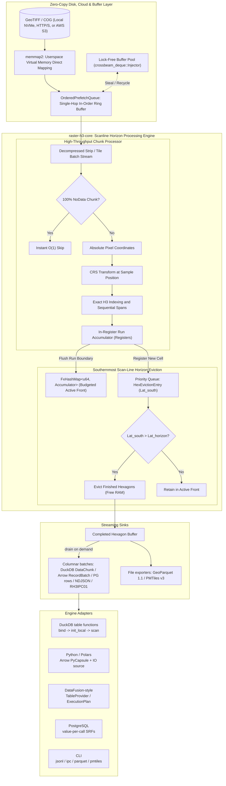

# raster_h3: High-Performance GeoTIFF-to-H3 Hexagonal Aggregation

[](https://opensource.org/licenses/MIT)
[](https://www.rust-lang.org)
[](docs/engines/duckdb.md)
[](docs/engines/python-polars.md)
[](docs/engines/postgresql.md)

A pure-Rust engine that aggregates multi-gigabyte geospatial rasters (GeoTIFF, Cloud-Optimized GeoTIFFs) into [Uber H3](https://h3geo.org/) hexagonal grid cells — and generates cloud-native **PMTiles v3** vector pyramids for instant web visualization. Aggregation runs in a [bounded memory budget](docs/engineering.md#1-southernmost-scan-line-horizon-eviction) and spills to disk when needed. The same engine ships as a native DuckDB extension, DataFusion-style table providers, a Python/Polars package, a PostgreSQL extension and a command-line tool (see [Engines](#engines)).

Supports **continuous** surfaces (elevation, temperature, NDVI, precipitation) and **categorical** classifications (land cover, zoning, soil types) with dedicated streaming engines.

Statistics use pixel contributions, not ground-area weights. CRS projection tolerances do not imply the same absolute WGS84 datum accuracy; NAD83 and ETRS89 paths include documented approximations. See [accuracy and weighting contracts](docs/testing.md#accuracy-and-weighting-contracts) for interpretation and regression coverage.

| Output | Use Case | Available In |
| :--- | :--- | :--- |
| **H3 table / Arrow stream** | SQL analytics, JOINs, DataFrames | DuckDB, Python/Polars, PostgreSQL, DataFusion, CLI (NDJSON / `RH3IPC01`) |
| **PMTiles v3** | Web maps — zero servers, one file | DuckDB, Python, CLI |
| **GeoParquet 1.1** | GIS interchange (QGIS, GeoPandas, BigQuery) | DuckDB, Python, CLI |

---

## 📖 Table of Contents

- [Motivation & Project Goals](#motivation--project-goals)
- [How It Works](#how-it-works)
- [Engines](#engines)
- [Core Engineering Architecture](#core-engineering-architecture)
- [Architecture Diagram](#architecture-diagram)
- [Core Dependencies](#core-dependencies--architectural-contributions)
- [Troubleshooting & Common Pitfalls](#troubleshooting--common-pitfalls)
- [Building & Testing Locally](#building--testing-locally)
- [Deep Dives](#-deep-dives)
- [License](#license)

---

## Motivation & Project Goals

### The Problem: The Raster-Tabular Divide

Geospatial data exists in two incompatible formats:

1. **Tabular / Vector Data**: Points, polygons, GPS traces, and demographic records in relational databases (DuckDB, Snowflake, BigQuery, PostgreSQL).
2. **Raster Grids**: 2D pixel matrices in GeoTIFF files — satellite imagery, elevation models, climate grids, land cover maps.

Joining raster values (elevation, temperature, land cover) with business entities (customers, routes, parcels) has traditionally required complex, slow, memory-intensive ETL pipelines.

### The Solution: Uber H3 Discrete Global Grid System

The **Uber H3 Spatial Index** divides the Earth into a hierarchical grid of invariant hexagons across 16 resolution levels. Unlike square grids, hexagons have identical distances to all six neighbors and minimal area distortion across global latitudes.

Aggregating rasters into H3 solves four fundamental challenges of working with raw imagery:
* **Normalizes Disparate Resolutions & Projections**: Rasters arrive with differing pixel sizes (10m Sentinel, 30m Landsat, 1km climate grids) and incompatible local projections. H3 maps them all into a single, standardized global grid without manual grid resampling.
* **Drastic 50×–100× Data Reduction**: An H3 Resolution 8 cell aggregates roughly 800 thirty-meter pixels into a single summary row, shrinking a multi-gigabyte raster by orders of magnitude on disk.
* **Preserves Rich Surface Distributions**: Rather than losing nuance to a simple average, the engine captures the full distribution per cell—including mean, variance/ruggedness, and min/max for continuous terrain, plus class purity and Shannon entropy (landscape fragmentation) for categorical maps.
* **Unlocks Relational Joins**: Every hexagon is addressed by a compact 64-bit integer (`UBIGINT` / `UInt64` / hex string). Once pixels become H3 cells, rigid 2D raster matrices become standard relational tables joinable directly with tabular business data: `JOIN ON r.h3_index = v.h3_index`.

For more details on the grid system and its mathematical design, see the [official H3 documentation](https://h3geo.org/docs/) and the [Uber engineering blog](https://www.uber.com/blog/h3/).

### Raster Meets Table: Worked Examples

Every engine can index pixels onto four grids (H3, A5, S2 and HEALPix), and each grid is good at
something different. The four examples below each pair a real question with the engine and grid
that suit it, and each joins a raster to vector or tabular data, either on a shared cell id or on
cell shapes.

| Question | Engine | Grid | What the grid brings |
| :--- | :--- | :--- | :--- |
| [Wetland loss inside vs. outside protected areas](#1-wetland-loss-inside-vs-outside-protected-areas--polars-on-a5) | Python & Polars | A5 | Equal-area cells, so cell fractions add up to true km² |
| [Flood depth at parcels and roads](#2-flood-depth-at-parcels-and-roads--duckdb-on-h3) | DuckDB | H3 | Hexagons, the grid other datasets are most often indexed on |
| [Snowpack per sub-basin, rolled up to the basin](#3-snowpack-per-sub-basin-rolled-up-to-the-basin--sedonadb-on-s2) | SedonaDB | S2 | Exact nesting: four children tile their parent |
| [Land temperature by latitude band](#4-land-temperature-by-latitude-band--cli-on-healpix) | CLI | HEALPix | Equal-area cells laid out in rings of constant latitude |

Without a shared spatial index, each of these needs a GIS overlay: reprojecting rasters, clipping
polygons, rasterizing geometries and managing gigabytes of scratch files. With `raster_h3`, the
raster becomes a table of cells and the rest is a join.

#### 1. Wetland loss inside vs. outside protected areas — Polars on A5

**The question**: *How much wetland did coastal Louisiana lose between 2001 and 2021, and did
strictly protected land lose less?*

**Data**: two 30-meter NLCD land cover rasters (2001 and 2021) and the PAD-US protected areas
database.

**Why A5**: every A5 cell at a resolution has the same area, so a cell's wetland fraction times one
constant is wetland area in km², and summing those gives a total with no grid bias (H3 cells vary
in area by location). NLCD is in an equal-area projection (EPSG:5070), so each pixel's share of a
cell is also its share of the ground: the whole chain conserves area.

```python
# pip install "./crates/raster-h3-python[polars]" geopandas
import geopandas as gpd
import polars as pl
import raster_h3
import shapely

RES = 14                                        # A5 cells of about 0.127 km² (~140 NLCD pixels)
CELL_KM2 = 510_065_622 / (60 * 4 ** (RES - 1))  # equal area: Earth's area / number of cells
BBOX = (-93.9, 28.9, -88.8, 30.6)               # coastal Louisiana, lon/lat

# 1. Wetland share of every A5 cell, one lazy scan per year
def wetland_share(path, year):
    return (
        raster_h3.scan_raster_h3(
            path, RES, grid="a5", categorical=True, format="long",
            remap={90: 1, 95: 1, "else": 0},  # woody + emergent wetland -> 1, everything else -> 0
            bbox=BBOX, columns=["a5_index", "category", "fraction"],
        )
        .filter(pl.col("category") == 1)
        .select("a5_index", pl.col("fraction").alias(f"wet_{year}"))
    )

wetland = (
    wetland_share("nlcd_2001_land_cover.tif", 2001)
    .join(wetland_share("nlcd_2021_land_cover.tif", 2021),
          on="a5_index", how="full", coalesce=True)
    .with_columns(pl.col("wet_2001", "wet_2021").fill_null(0.0))  # no wetland that year = no row
)

# 2. Polyfill strictly protected areas (GAP status 1 and 2) into the same A5 cells.
#    The default containment, 'contains_centroid', gives a cell to a polygon only if the cell's
#    centre is inside it; unique() drops cells shared by overlapping designations.
padus = gpd.read_file(
    "PADUS4_1Geodatabase.gdb", layer="PADUS4_1Fee",
    bbox=gpd.GeoSeries([shapely.box(*BBOX)], crs=4326),
).to_crs(4326)
padus = padus[padus["GAP_Sts"].isin(["1", "2"])]
protected = pl.DataFrame(
    {"a5_index": [c for g in padus.geometry
                  for c in raster_h3.polygon_to_cells(g.wkb, RES, grid="a5") or []]},
    schema={"a5_index": pl.UInt64},
).unique().with_columns(protected=pl.lit(True))

# 3. Wetland area and loss, inside vs. outside protected land
result = (
    wetland.join(protected.lazy(), on="a5_index", how="left")
    .with_columns(pl.col("protected").fill_null(False))
    .group_by("protected")
    .agg(
        (pl.col("wet_2001").sum() * CELL_KM2).alias("wetland_2001_km2"),
        (pl.col("wet_2021").sum() * CELL_KM2).alias("wetland_2021_km2"),
    )
    .with_columns(
        lost_km2=pl.col("wetland_2001_km2") - pl.col("wetland_2021_km2"),
        lost_pct=(1 - pl.col("wetland_2021_km2") / pl.col("wetland_2001_km2")) * 100,
    )
    .collect()
)
```

In Polars, both rasters are `LazyFrame`s, read only when `.collect()` runs, so the two-year
comparison is just a join and a `group_by`. Drop the `remap` and `pivot` on `category` to get a
full from→to change matrix in km². `columns=` is pushed into the scan, and `bbox` limits how much
of the raster is read. One caveat: the engine weights statistics by pixel, not by ground area
(see [ground-area weighting](docs/local-grids-and-ground-area.md)). That's exact here only because
every NLCD pixel covers the same 900 m², which also gives a cross-check: `count × 900 m²` from the
same scan should match. See the [Python scan parameters](docs/engines/python-polars.md#scan-parameters).

#### 2. Flood depth at parcels and roads — DuckDB on H3

**The question**: *In a 100-year flood in Houston, which parcels take on more than 30 cm of water,
and how many kilometres of road become impassable?*

**Data**: a 100-year flood depth GeoTIFF (metres), a county parcel GeoParquet file, and Overture
Maps road segments read directly from S3.

**Why H3**: resolution-11 hexagons (about 2,150 m²) are roughly parcel-sized, and H3 is the grid
other datasets you might join later are most likely to be indexed on already.

```sql
INSTALL spatial; LOAD spatial;
INSTALL httpfs;  LOAD httpfs;
SET s3_region = 'us-west-2';

-- 1. Flood depth into H3 resolution-11 hexagons. WHERE runs after aggregation,
--    so bbox is what keeps the scan to the city.
CREATE TABLE flood_h3 AS
SELECT h3_index, max AS max_depth_m, p90 AS p90_depth_m, geom
FROM h3_raster_continuous_aggregate(
    'flood_depth_100yr.tif', resolution := 11,
    quantiles := 'p90',                 -- streaming 90th percentile per hexagon
    geom := true,                       -- native GEOMETRY column for the road join
    bbox := '-95.80,29.52,-95.01,30.11'
)
WHERE max >= 0.3;                       -- ~30 cm: enough to stall or float a car

-- 2. Parcels from GeoParquet. 'covers' keeps parcels smaller than a hexagon.
CREATE TABLE parcels_h3 AS
SELECT parcel_id, land_use, assessed_value,
       unnest(h3_polygon_to_cells(ST_AsWKB(geometry), 11, 'covers')) AS h3_index
FROM read_parquet('harris_county_parcels.parquet');

-- 3. Road segments straight from Overture's public S3 bucket; the bbox struct
--    lets DuckDB skip row groups outside the city
CREATE TABLE roads AS
SELECT id, class, geometry
FROM read_parquet(
    's3://overturemaps-us-west-2/release/<release>/theme=transportation/type=segment/*',
    hive_partitioning = true)
WHERE subtype = 'road'
  AND bbox.xmin > -95.80 AND bbox.xmax < -95.01
  AND bbox.ymin >  29.52 AND bbox.ymax <  30.11;

-- 4a. Flooded parcels: an integer hash join on the shared H3 index, then one row per parcel
--     (a parcel can span several hexagons)
WITH parcel_depth AS (
    SELECT p.parcel_id,
           any_value(p.land_use)       AS land_use,
           any_value(p.assessed_value) AS assessed_value,
           max(f.p90_depth_m)          AS depth_m
    FROM parcels_h3 AS p
    JOIN flood_h3 AS f USING (h3_index)
    GROUP BY p.parcel_id
)
SELECT land_use,
       count(*)              AS parcels_flooded,
       round(avg(depth_m), 2) AS avg_depth_m,
       sum(assessed_value)   AS value_at_risk
FROM parcel_depth
GROUP BY land_use
ORDER BY value_at_risk DESC;

-- 4b. Impassable road length: roads are lines, so join on shape. Hexagons don't overlap,
--     so summing each road's piece inside each hexagon counts no length twice.
SELECT r.class,
       round(sum(ST_Length_Spheroid(ST_FlipCoordinates(
           ST_Intersection(r.geometry, f.geom)))) / 1000, 1) AS km_impassable
FROM roads AS r
JOIN flood_h3 AS f ON ST_Intersects(r.geometry, f.geom)
GROUP BY r.class
ORDER BY km_impassable DESC;
```

DuckDB's advantage is reach: one session reads a local GeoTIFF, a GeoParquet file and a remote
dataset on S3, and joins them with a hash join where polygons can be polyfilled and a spatial join
where lines can't. The same SQL runs from the DuckDB CLI or from Python, Node.js and R. DuckDB
also exposes every engine option, including quantiles, compaction and memory budgets. Unlike
SedonaDB, `WHERE` filters apply after aggregation, so narrow the scan with `bbox := '...'`.

#### 3. Snowpack per sub-basin, rolled up to the basin — SedonaDB on S2

**The question**: *On April 1, how much snow water does each sub-basin of the Colorado Headwaters
hold, and how much does the basin hold as a whole?*

**Data**: SNODAS daily snow water equivalent (1 km, millimetres, as GeoTIFF) and the USGS
Watershed Boundary Dataset's HUC8 sub-basins.

**Why S2**: an S2 cell's four children tile it exactly (H3's children don't), so fine cells roll up
to coarse cells with no gaps or overlaps. Each cell is also given to exactly one sub-basin, so
sub-basins add up to the basin.

```python
# Build the bindings: cd crates/raster-h3-sedona/python && maturin develop --release
# pip install "sedonadb==0.5.0" geoarrow-pyarrow pandas pyogrio pyproj geopandas
import geopandas as gpd
import sedonadb
import shapely
import raster_h3_sedona
from raster_h3_sedona import RasterH3Table

sd = sedonadb.connect()
sd.register(raster_h3_sedona.scalar_functions())

# HUC8 sub-basins of the Colorado Headwaters basin (HUC6 140100)
huc8_path = "wbd_huc8_140100.geojson"
basin_box = shapely.box(*gpd.read_file(huc8_path).to_crs(4326).total_bounds).wkt

# 1. Snow water equivalent on S2 level-13 cells (~1.3 km²), scanned lazily by each query
sd.create_data_frame(
    RasterH3Table.continuous("snodas_swe_20260401.tif", 13, grid="s2", nodata=-9999)
).to_view("swe_s2")
sd.read_pyogrio(huc8_path).to_view("huc8")

# 2. A filter against a fixed shape limits the scan to the tiles near the basin;
#    the rest of the CONUS raster is never aggregated
sd.sql(f"""
    SELECT s2_index, mean AS swe_mm, count, wkb
    FROM swe_s2
    WHERE ST_Intersects(wkb, ST_SetSRID(ST_GeomFromWKT('{basin_box}'), 4326))
""").to_view("swe_cells")

# 3. Each cell goes to the one sub-basin that holds its centre, and ROLLUP adds the
#    basin total (HUC6 = the first six digits of HUC8) from the same rows
by_basin = sd.sql("""
    WITH cells AS (
        SELECT h.huc8, c.swe_mm, c.count
        FROM swe_cells AS c
        JOIN huc8 AS h ON ST_Contains(h.wkb_geometry, ST_Centroid(c.wkb))
    )
    SELECT
        substr(huc8, 1, 6)                                   AS huc6,
        huc8,                                                -- NULL on the basin total row
        round(sum(swe_mm * count) / sum(count), 1)           AS mean_swe_mm,
        round(sum(CASE WHEN swe_mm > 0 THEN count ELSE 0 END) / sum(count), 2)
                                                             AS snow_covered_share
    FROM cells
    GROUP BY ROLLUP (substr(huc8, 1, 6), huc8)
    ORDER BY huc6, huc8 NULLS FIRST
""").to_pandas()

# 4. Level-9 parents (~320 km²) are exact unions of their level-13 children, so these
#    pixel-weighted means equal a direct level-9 scan. Tile them for a web map.
raster_h3_sedona.write_pmtiles(sd.sql("""
    SELECT s2_cell_to_parent(s2_index, 9) AS s2_index,
           sum(swe_mm * count) / sum(count) AS mean_swe_mm
    FROM swe_cells
    GROUP BY 1
"""), "swe_s2_level9.pmtiles")
```

SedonaDB is a spatial engine, so the sub-basins don't need polyfilling: the join matches cell
shapes to basin shapes directly. It's also the only one of the three engines where a spatial
condition skips raster: `ST_Intersects(wkb, <constant shape>)` limits the scan to the tiles near
that shape, and `count >= n` or `mean >= x` drop cells inside the scan rather than after it.
S2 cells aren't equal-area, so this example reports pixel-weighted means and shares, not totals in
km². To join on cell ids instead, as DuckDB and Polars do, see [DataFusion &
SedonaDB](docs/engines/datafusion.md#from-sedonadbs-python-api).

#### 4. Land temperature by latitude band — CLI on HEALPix

**The question**: *How does average land temperature change from pole to pole?*

**Data**: WorldClim 2.1 annual mean temperature (BIO1), a 10-arc-minute global GeoTIFF.

**Why HEALPix**: every cell has the same area, and the cells sit in rings of constant latitude.
So a plain average of cells in a latitude band is an area-weighted average. Averaging a lon/lat
raster's pixels directly gets this wrong: pixels shrink toward the poles, so high latitudes get
too much weight.

```bash
# 1. Aggregate the global raster onto HEALPix depth-8 cells (786,432 cells of ~649 km² each),
#    straight to GeoParquet. No database, no Python.
raster-h3-cli parquet wc2.1_10m_bio_1.tif --grid healpix -r 8 -o bio1_healpix8.parquet

# 2. The same scan as a web map: one PMTiles archive, zooming from depth 4 to depth 8
raster-h3-cli pmtiles wc2.1_10m_bio_1.tif --grid healpix -r 4,5,6,7,8 -o bio1_healpix.pmtiles

# 3. Summarise by 10° band with any Parquet reader; here the DuckDB CLI, which needs only
#    its spatial extension to read the cells' latitude, not raster_h3
duckdb -c "
INSTALL spatial; LOAD spatial;
SELECT floor(ST_Y(ST_Centroid(geometry)) / 10) * 10   AS band_south_deg,
       count(*)                                       AS land_cells,
       round(count(*) * 510065622 / (12 * pow(4, 8))) AS land_km2,    -- cells x one constant area
       round(avg(mean), 1)                            AS mean_temp_c  -- area-weighted: equal cells
FROM 'bio1_healpix8.parquet'
GROUP BY ALL
ORDER BY band_south_deg DESC"
```

The CLI's advantage is that it needs nothing else installed: one executable (also put on `PATH`
by the Python wheel) that suits shell scripts, cron jobs and CI. It writes GeoParquet or PMTiles
directly, or streams NDJSON to stdout (`raster-h3-cli jsonl ... | jq`). It has no SQL of its own,
so the band summary runs in whatever reads Parquet next. The CLI exposes the common options
(grid, resolutions, CRS, NoData, bbox, categorical layout); see the [CLI deep dive](docs/engines/cli.md).

WorldClim has no data over the ocean, so only land cells are written. `land_km2` is approximate
because a coastal cell counts in full. Each cell's centroid latitude lands within a fraction of a
cell (a cell is about 0.2° across) of its ring's latitude, which is plenty for 10° bands. Within each cell the
engine still weights by pixel, but at depth 8 (about 25 km across) the latitude change inside a
cell is small except right at the poles.

> No GDAL. No intermediate files. The raster *becomes* a queryable table source — a SQL table function in DuckDB, a `LazyFrame` in Polars, a table provider in SedonaDB, a file in one command from the CLI — on whichever grid fits the question.

### Why Intermediate H3 Aggregations Change Everything

Materializing both raster and vector datasets into intermediate H3 tables (or Parquet files) provides fundamental architectural advantages over traditional GIS workflows:

#### 1. Benefits for Vector Datasets
* **Polyfill Once, Eliminate Geometry Math**: Administrative boundaries (census tracts, voting precincts, parcel lots) often contain thousands of vertices. Evaluating spatial containment (`ST_Contains`, `ST_Intersects`) across millions of records is computationally brutal. Polyfilling vector polygons into H3 cells once eliminates all downstream polygonal math.
* **Decoupled Update Cycles**: Demographic tables, property boundaries, and customer records update frequently (daily, monthly, or annually), while foundational rasters (elevation DEMs, land cover) change rarely. Pre-indexing vectors into H3 lets you incorporate updated vector tables with a 50ms hash join—without re-reading a 50 GB raster.
* **Standardizing Irregular Shapes (MAUP Mitigation)**: Census tracts and zip codes vary radically in area—a rural tract can be 1,000× larger than an urban one, severely distorting statistical comparisons. Polyfilling vectors into uniform cells discretizes irregular boundaries into near-equal spatial units (exactly equal-area on the A5 and HEALPix grids).

#### 2. Benefits for Raster Ingestion
* **Scan Once, Query Everywhere**: Decompressing and processing an 8–50 GB GeoTIFF (billions of pixels) is an intensive operation you only want to do once. Once aggregated into a table like `flood_h3` or exported to Parquet, downstream analyses query in milliseconds without touching raw raster pixels again.
* **Drastic Storage Reduction**: A multi-gigabyte raster compresses into a compact, columnar H3 table that is 50×–100× smaller on disk. You can easily version-control it, store it in your cloud data lake (S3/R2), or query it from DuckDB, Polars, PostgreSQL, Snowflake, or BigQuery.

#### 3. Benefits for Spatial Joining & Visualization
* **$O(1)$ Hash Joins vs $O(N \times M)$ Geometry Math**: Converting both raster pixels and vector polygons to 64-bit integer H3 cells replaces expensive topological intersection algorithms with hardware-speed **integer equality hash joins** (`JOIN ON c.h3_index = t.h3_index`).
* **Universal Lingua Franca**: Any number of disparate rasters (elevation, temperature, canopy) and vector layers (demographics, parcels, sensor points) can be joined together in a single multi-way query—eliminating projection mismatches, resolution differences, and resampling errors.
* **Direct PMTiles from Vector Parquet**: Intermediate H3 vector tables stored in Parquet can be transcoded directly into multi-zoom web map pyramids (DuckDB `h3_parquet_to_pmtiles`) without Tippecanoe, GDAL, or GeoJSON scratch files. Zoom bands span the table's resolutions, and `COPY ... (min_zoom, max_zoom)` (Rust: `ExternalFeatureExport::with_zoom_limits`) clips the range.

### From Query to Web Map in One Step

`raster_h3` can export results directly to a **PMTiles v3** single-file vector tile archive — a multi-resolution pyramid ready for MapLibre, Kepler.gl, or Felt with zero intermediate files and zero tile servers:

```bash
raster-h3-cli pmtiles nlcd_landcover_2021.tif -c -r 5,6,7,8 -o landcover_canopy.pmtiles
```

```python
raster_h3.raster_to_pmtiles("nlcd_landcover_2021.tif", "landcover_canopy.pmtiles", [5, 6, 7, 8], categorical=True)
```

```sql
-- DuckDB
SELECT * FROM h3_raster_to_pmtiles(
    'nlcd_landcover_2021.tif', 'landcover_canopy.pmtiles',
    min_resolution := 5, max_resolution := 8, categorical := true
);
```

Upload `landcover_canopy.pmtiles` to S3, R2, or GitHub Pages, open it in MapLibre GL JS, and zoom from state level to city block.

A web map needs tiles at every zoom level — from hemispheric overview down to street-level detail. `raster_h3` builds this entire multi-resolution pyramid in a single pass over the raster, aggregating pixels simultaneously across all requested H3 resolutions. See [PMTiles & Multi-Resolution](docs/pmtiles.md) for the full deep dive.

### Design Principles

| Principle | What It Means |
| :--- | :--- |
| **Pure Rust, Zero C++ Dependencies** | No GDAL, PROJ or Python runtime; each engine ships as one native library or binary |
| **One Core, Many Engines** | DuckDB, DataFusion, Python/Polars, PostgreSQL and the CLI all drive the same streamers and return the same cells |
| **Budgeted aggregation** | Configurable accumulator budget with disk spilling; total RAM also includes decoding and prefetch buffers |
| **Multi-Core Throughput** | Raster chunks aggregated in parallel windows across CPU cores |
| **Native PMTiles v3 Export** | Single-file web maps — zero Tippecanoe, zero tile servers |
| **Native GeoParquet 1.1 Export** | Stack-allocated WKB polygons with PROJJSON metadata |
| **Cloud-Native Streaming** | HTTP/S3 COG range prefetching — no local copies needed |
| **Sub-Pixel Super-Sampling** | RGSS, Hex, Gaussian, 8-Rooks boundary anti-aliasing |

Built-in HTTP/S3 reads pin strong ETags per URL and use `If-Match`, failing if the
object changes during a scan. Rust `HttpTransport` clones share each URL's pin:
changing `url` selects an independent validator, and returning to a previous URL
retains its original pin. Servers with weak or missing ETags have no snapshot
guarantee; use immutable/versioned URLs. A server that ignores `Range` sends the
whole file into memory, so such downloads are capped at 1 GiB; raise the cap with
`RASTER_H3_MAX_FULL_BODY_BYTES`. See [remote COG streaming](docs/engines/core.md#remote-cog-prefetching).

---

## How It Works

`raster_h3` reads a raster like a document scanner: one strip at a time, from north to south.

- **Finished hexagons leave early.** Once the scan has passed a hexagon's southern
  edge, no later row can touch it, so its statistics are final and it is sent on and
  freed. Memory holds only the band of hexagons under the scanner, not the whole raster.
- **Results stream into your tool.** Cells arrive in DuckDB, Polars, PostgreSQL,
  DataFusion or the CLI as they finish, so joins and exports can start before the raster
  is fully read, and a `LIMIT` can stop the scan early.
- **Memory stays within a budget.** If the active hexagons outgrow the aggregation
  budget (64 MiB by default), partial results spill to temporary files on disk and are
  merged at the end.
- **Some inputs wait for the end.** After a spill, and for projections whose chunk bounds
  can't be certified (many PROJ-string projections, Albers chunks near the cone apex), the scanner
  can't prove a hexagon is finished, so cells are held until the whole file is read.
  See [Bounding boxes and pruning](docs/crs-and-projection.md#bounding-boxes-and-pruning)
  for which projections are certified.
- **One pass, every resolution.** Each pixel is located once and counted at every
  requested H3 resolution, which is how a multi-zoom PMTiles pyramid comes from a
  single read.

See [Core Engineering Architecture](#core-engineering-architecture) for how each step is
implemented.

---

## Engines

The repository is a Cargo workspace: `raster-h3-core` does all decoding, reprojection,
aggregation and export, and each engine crate is a thin adapter over it, so every engine
returns the same cells and statistics for the same input.

| Engine | Crate | Get it | Docs |
| :--- | :--- | :--- | :--- |
| **DuckDB** | `raster-h3-duckdb` | Pre-built `.duckdb_extension` from [Releases](https://github.com/dmuldrew/raster_h3/releases), Docker, or `cargo build --release` → `libraster_h3.{so,dylib,dll}` | [DuckDB deep dive](docs/engines/duckdb.md) · [SQL API Reference](docs/sql-api-reference.md) |
| **Python / Polars** | `raster-h3-python` | `pip install ./crates/raster-h3-python` (wheels are built in CI; not yet on PyPI) | [Python & Polars](docs/engines/python-polars.md) · [Polars API Reference](docs/polars-api-reference.md) |
| **PostgreSQL 13–18** | `raster-h3-pg` | `cargo build -p raster-h3-pg --features pg-extension` | [PostgreSQL](docs/engines/postgresql.md) |
| **Apache DataFusion / SedonaDB** | `raster-h3-sedona` | Cargo dependency (DataFusion pinned to SedonaDB's version); SedonaDB Python: `maturin build` in `crates/raster-h3-sedona/python` | [DataFusion & SedonaDB](docs/engines/datafusion.md#using-with-apache-datafusion-and-sedonadb) |
| **Apache Spark / Apache Sedona** | `raster-h3-python` (on every executor) | The `raster-h3` wheel (`raster_h3.spark` data source on Spark 4.0+); or `docker compose up --build sedona` (Apache Sedona 1.9.1, Spark 4.0) | [Spark & Apache Sedona](docs/engines/spark.md) |
| **CLI** | `raster-h3-cli` | `cargo build --release -p raster-h3-cli` (also in the Python wheel) | [CLI](docs/engines/cli.md) |
| **Rust library** | `raster-h3-core` | Cargo dependency | [Core Engine](docs/engines/core.md) |

**Grids.** Besides Uber H3 (resolutions 0–15), every engine indexes pixels onto A5
pentagons (0–30), Google S2 cells (levels 0–30, 64-bit cell ids) and HEALPix
cells (nested scheme, depths 0–29, NUNIQ ids `4 * 4^depth + pixel`). Each grid has its own
SQL functions (`s2_raster_continuous_aggregate`, `healpix_lonlat_to_cell`, ...; or
`grid := 's2'` on the H3 ones) and output columns (`s2_index`, `s2_hex`); the CLI takes
`--grid h3|a5|s2|healpix`, Python and SedonaDB a `grid` option, and PostgreSQL has
`{grid}_raster_*_aggregate` functions. See the [DuckDB registered functions](docs/engines/duckdb.md#registered-functions).

Feature coverage differs per engine: DuckDB exposes every parameter (sampling, bands,
spectral formulas, quantiles, remapping, budgets), DataFusion exposes most of them through
builders, Python exposes all but compaction, single-cell pushdown and resource budgets
(and pushes Polars filters into the engine), and PostgreSQL and the CLI expose the common subset (resolutions, CRS, NoData, bbox,
categorical layout). The [Engines Overview](docs/engines/README.md) has the
full capability matrix, shared output schemas, a side-by-side cheat sheet and the
cross-engine parity tests. Each engine deep dive covers install, recipes (basic and
advanced scans, scalar helpers, joins, exports, remote COGs, mosaics, categorical queries),
internals and troubleshooting.

### Quick Start

**DuckDB**

```sql
LOAD 'target/release/libraster_h3.dylib'; -- or INSTALL from a release, see the DuckDB deep dive
SELECT h3_hex, mean, count
FROM h3_raster_continuous_aggregate('dem.tif', resolution := 8)
LIMIT 5;

-- Polyfill a WKB polygon: list of UBIGINT cells; containment defaults to 'contains_centroid'
SELECT h3_polygon_to_cells(ST_AsWKB(geom), 8, 'covers') AS cells FROM areas;
```

See [`h3_polygon_to_cells`](docs/sql-api-reference.md#h3_polygon_to_cells) for the containment modes
(also available in Python as `raster_h3.h3_polygon_to_cells`).

**Python / Polars**

```python
import polars as pl
import raster_h3

df = (raster_h3.scan_raster_h3("dem.tif", 8)
        .filter(pl.col("count") > 10)
        .select("h3_hex", "mean", "count")
        .collect())
```

**PostgreSQL**

```sql
CREATE EXTENSION raster_h3;
SELECT h3_hex, mean, count FROM h3_raster_continuous_aggregate('/data/dem.tif', 8) LIMIT 5;
```

**CLI**

```bash
raster-h3-cli jsonl dem.tif -r 8 --columns h3_hex,mean,count --limit 5
raster-h3-cli parquet dem.tif -r 7,8 -o dem_h3.parquet
```

**Raster scans without a `SessionContext`** (`raster_h3_sedona::scan`)

```rust
use raster_h3_sedona::scan::{ContinuousRasterTableProvider, FilterPredicate, RasterScan};

let provider = ContinuousRasterTableProvider::try_new("dem.tif", vec![8])?;
let plan = provider.scan(Some(&[0, 2]), &[FilterPredicate::MinCount(10.0)], Some(1000))?;
for batch in plan.execute()? { /* RecordBatch with h3_index, mean */ }
```

This is the layer under the DataFusion adapter below. Call `supports_filters_pushdown` to learn
which predicates you still have to apply to the scan's rows. With compaction on, it reports every predicate `Unsupported` and the scan returns
the full compacted table; `RasterH3Table` (below) then leaves those `WHERE` clauses to
DataFusion. The adapter defers `LIMIT` until after all residual filters, including inexact
pushdowns. See [filter pushdown](docs/engines/datafusion.md).

**Apache DataFusion / SedonaDB**

```rust
let ctx = sedona::context::SedonaContext::new_local_interactive().await?;
raster_h3_sedona::register_all(&ctx.ctx); // or a plain datafusion SessionContext
ctx.sql("SELECT h3_index, mean FROM h3_raster_continuous_aggregate('dem.tif', 8) WHERE count >= 10")
    .await?
    .show()
    .await?;
```

**Rust library**

```rust
use raster_h3_core::aggregator::multi_horizon::MultiResolutionConfig;
use raster_h3_core::columnar::ContinuousBatchReader;
use raster_h3_core::raster::mosaic::resolve_raster_sources;

let paths = resolve_raster_sources("dem.tif")?;
let reader = ContinuousBatchReader::open(&paths, &MultiResolutionConfig::new(vec![8]), None, 2048, None)?;
```

Continuous readers build per-cell quantile sketches only when a configured quantile
column is projected (or the full schema is requested). The schema is unchanged;
`ContinuousBatchReader::tracks_quantiles()` reports the decision, and
`columnar::quantiles_projected()` exposes the projection rule.
`aggregator::multi_horizon::QuantilePlan` evaluates projected percentiles and IQR
with one sketch sweep per cell, sharing repeated probabilities. See the
[core engine guide](docs/engines/core.md#batched-quantile-evaluation) for details.

### Partitioned scans (distributed workers)

One raster or mosaic can be split across independent workers (Spark tasks, batch jobs)
that each read a disjoint set of TIFF tiles, with results identical to a single scan:
plan the partitions from metadata, scan each one, then merge the few cells that straddle
a partition edge. Rows whose `partial_state` column is null are final; the others are
merged per cell.

```python
import pyarrow as pa, pyarrow.compute as pc, raster_h3

specs = raster_h3.plan_partitions("dem.tif", target_chunks=256)          # driver
parts = [pa.table(raster_h3.RasterH3ArrowStream("dem.tif", 8, partition=s))  # workers
         for s in specs]
cells = pa.concat_tables(parts)
final = cells.filter(pc.is_null(cells["partial_state"])).drop(["partial_state"])
merged = raster_h3.merge_partials(cells.filter(pc.is_valid(cells["partial_state"])))
```

The SQL engines merge with an aggregate, so a `GROUP BY` gathers each cell's partial rows:

```sql
-- DuckDB (SedonaDB SQL is the same, with the spec as a string argument)
SELECT spec FROM h3_raster_plan_partitions('dem.tif', target_chunks := 256);
SELECT * FROM h3_raster_continuous_aggregate('dem.tif', resolution := 8, partition := '<spec>');
SELECT h3_index, resolution, h3_merge_partials(partial_state) AS cell
FROM partial_rows GROUP BY h3_index, resolution;   -- cell.mean, cell.count, ...
```

From a shell, `raster-h3-cli plan` / `ipc --partition` / `merge` fan out with `xargs -P`
or batch jobs ([CLI guide](docs/engines/cli.md#partitioned-scans)).

In Rust the same steps are `plan_partitions`, `MultiResolutionConfig::partition` and
`PartialMerger` (DataFusion providers: `plan_partitions` / `with_partition`). See
[Partitioned scans](docs/engines/core.md#partitioned-scans) and the
[Python](docs/engines/python-polars.md#partitioned-scans-spark-and-other-distributed-engines),
[Spark & Apache Sedona](docs/engines/spark.md),
[DuckDB](docs/engines/duckdb.md#partitioned-scans) and
[DataFusion / SedonaDB](docs/engines/datafusion.md#partitioned-scans) guides.

---

## Core Engineering Architecture

`raster_h3`'s throughput and memory profile come from seven principles, shared by every engine:

| # | Engineering Pillar | Impact |
| :---: | :--- | :--- |
| 1 | **Southernmost Scan-Line Horizon Eviction** | Bounded aggregation memory: cells are emitted as soon as they are certified complete; disk spilling otherwise |
| 2 | **Sequential H3 Spans & In-Register Run Accumulation** | One H3 lookup per pixel, but ~98% fewer hash table updates: equal-cell runs accumulate in registers and flush once |
| 3 | **ROI Bounding Box Chunk Pruning** | Non-intersecting chunks skipped before any read or decompression, for CRSs with certified bounds, including EPSG:3413/3031 polar grids ([details](docs/crs-and-projection.md#bounding-boxes-and-pruning)) |
| 4 | **Work-Stealing Parallelism** | Rayon kernel windows in every engine, which also compute each new cell's eviction key so the serial merge stays short ([measurements](docs/worker-scaling.md)); DuckDB additionally scans with one `init_local` state per thread |
| 5 | **Bounded Prefetch & Decode Pipeline** | `memmap2` zero-copy reads, parallel decompression into a single-hop in-order ring, and recycled buffers under `decode_budget_bytes` |
| 6 | **Coalesced Cloud Range Reads** | Adjacent COG/S3 tile ranges merged into single HTTP requests and prefetched ahead of the decoders |
| 7 | **Exact CRS Transformation with Analytical Fast Paths** | Every sample transformed at its true position; identity and analytical Web Mercator/Albers paths skip Proj4 and supply the certified bounds that pruning and eviction rely on |

> 📖 **Detailed explanations** of each architectural pillar — See [docs/engineering.md](docs/engineering.md)  
> 🗺️ **Source Module Architecture** — File-by-file breakdown of crate internals mapped to these principles: [docs/module-architecture.md](docs/module-architecture.md)

---

## Architecture Diagram



> 🗺️ **Looking for source file responsibilities?** See the complete [Source Module Architecture](docs/module-architecture.md) for a guide to every file in the workspace.

---

## Core Dependencies & Architectural Contributions

Version requirements live in [Cargo.toml](Cargo.toml); resolved versions live in [Cargo.lock](Cargo.lock).

| Dependency | Purpose | Contribution |
| :--- | :--- | :--- |
| [`h3o`](https://crates.io/crates/h3o) | Pure-Rust H3 Engine | 100% Rust H3 DGGS — no C/C++ FFI overhead |
| [`memmap2`](https://crates.io/crates/memmap2) | Virtual Memory I/O | Zero-copy GeoTIFF mapping with sequential readahead |
| [`crossbeam-deque`](https://crates.io/crates/crossbeam-deque) | Lock-Free Buffer Pool | Concurrent work-stealing buffer recycling |
| [`libdeflater`](https://crates.io/crates/libdeflater) | SIMD Deflate | Hardware-accelerated decompression (AVX-512, NEON) |
| [`weezl`](https://crates.io/crates/weezl) | LZW Decoder | Fast streaming LZW for legacy GeoTIFFs |
| [`parquet`](https://crates.io/crates/parquet) | GeoParquet Engine | Streaming row-group writer with OGC GeoParquet 1.1 |
| [`tiff`](https://crates.io/crates/tiff) | GeoTIFF Decoder | Baseline TIFF, tiled TIFF, and BigTIFF support |
| [`proj4rs`](https://crates.io/crates/proj4rs) | Geodetic Reprojection | Pure-Rust PROJ.4 (UTM, Lambert, Albers → WGS84) |
| [`rustc-hash`](https://crates.io/crates/rustc-hash) | Fast Hasher | Maintained Fx hashing for numeric H3 cell keys (not a cryptographic hasher) |
| [`rayon`](https://crates.io/crates/rayon) | Work-Stealing Parallelism | Lock-free data parallelism across CPU cores |
| [`flate2`](https://crates.io/crates/flate2) | Tile Compression | Gzip for MVT payloads and PMTiles directories |
| [`thiserror`](https://crates.io/crates/thiserror) & [`serde`](https://crates.io/crates/serde) | Error & Serialization | Typed error propagation and JSON formatting |

---

## Troubleshooting & Common Pitfalls

Decoded TIFF chunks with invalid dimensions, overflowed layouts, or truncated source/destination
buffers return an error before sample unpacking rather than indexing unchecked layouts.

These apply to every engine. Engine-specific issues (DuckDB unsigned extensions, the
Python native library path, PostgreSQL privileges and version mismatches) are in each
deep dive's troubleshooting section: [DuckDB](docs/engines/duckdb.md#troubleshooting),
[Python](docs/engines/python-polars.md#troubleshooting),
[PostgreSQL](docs/engines/postgresql.md#troubleshooting).

### Missing or Non-Standard CRS

If a GeoTIFF lacks embedded projection tags, `raster_h3` halts with:
```
CRS transformation error: No CRS detected in raster metadata. A CRS must be specified explicitly.
```

This prevents silent spatial corruption — meter-based coordinates treated as degrees would place hexagons in the wrong location. Specify the CRS explicitly:

| Engine | Override |
| :--- | :--- |
| DuckDB | `h3_raster_continuous_aggregate('grid.tif', resolution := 8, source_crs := 'EPSG:32610')` |
| Python | `raster_h3.scan_raster_h3("grid.tif", 8, crs="EPSG:32610")` |
| PostgreSQL | `h3_raster_continuous_aggregate('/data/grid.tif', 8, source_crs => 'EPSG:32610')` |
| CLI | `raster-h3-cli jsonl grid.tif -r 8 --crs EPSG:32610` |
| DataFusion | `ContinuousRasterTableProvider::try_new("grid.tif", vec![8])?.with_crs("EPSG:32610")` |

Valid pixels whose transform fails or lands outside the valid latitude/longitude range are dropped rather than aborting the stream; they are counted by `transform_failures()` (core streamers and batch readers) and reported by the engines: a `transform_failures` column in DuckDB's export summaries, a PostgreSQL `WARNING`, a Python `RuntimeWarning` from the exporters and `scan_raster_h3`, and a CLI warning on stderr. DuckDB (`strict_transforms := true`), Python (`strict_transforms=True`) and DataFusion (`with_strict_transforms(true)`) can fail the query instead. See [transform-failure diagnostics](docs/engines/core.md#transform-failure-diagnostics).

For supported projection families, see [Supported CRS](docs/crs-and-projection.md). Helmert datum shifts (`+towgs84`, and built-in national grids such as `EPSG:27700` and `EPSG:28992`) are applied; grid-based shifts such as NAD27 are rejected (see [Datum Shifts](docs/crs-and-projection.md#datum-shifts)). To convert your dataset into zero-trig native WGS84 for maximum throughput, see [Optimal Raster Format & Ingestion Speed](docs/optimal-raster-format.md).

### Scaled Values (GDAL Scale/Offset) and Alpha

Bands that carry GDAL `SCALE`/`OFFSET` metadata (packed reflectance, temperatures) are
aggregated as physical values, `stored * scale + offset`, including quantiles and spectral
indices. NoData is matched on the stored value, categorical classes are never scaled, and
pixels whose TIFF alpha sample is `0` are excluded. Invalid scale/offset metadata (including
a zero or non-finite scale) is rejected when the file is opened, even in raw-value mode.
To aggregate stored values from files with valid metadata instead:

| Engine | Opt-out |
| :--- | :--- |
| DuckDB | `h3_raster_continuous_aggregate('lst.tif', resolution := 8, scale_offset := false)` |
| CLI | `raster-h3-cli jsonl lst.tif -r 8 --raw-values` |
| DataFusion | `ContinuousRasterTableProvider::try_new("lst.tif", vec![8])?.with_scale_offset(false)` |

Python and PostgreSQL always calibrate. See [Band calibration and validity](docs/sql-api-reference.md#band-calibration-and-validity).

### Antimeridian Crossing

For datasets spanning ±180° longitude, `raster_h3` automatically wraps coordinates. For ROI bounding box filters across the antimeridian, split into two queries (e.g., `[170.0, 180.0]` and `[-180.0, -170.0]`).

### BigTIFF & Codec Compatibility

Natively decodes TIFF 6.0 and BigTIFF (>4 GB) with: Raw, Deflate (Zlib), LZW, PackBits compression and `Float32/64`, `UInt8/16/32`, `Int8/16/32` pixel types. For unsupported codecs (JPEG2000, WebP, LERC), convert first:

```bash
gdal_translate -co COMPRESS=DEFLATE input.tif output.tif
```

For maximum ingestion throughput (up to 6× faster) and optimal L2 cache residency, see the recommended GDAL conversion recipes in the [Optimal Raster Format Deep Dive](docs/optimal-raster-format.md).

### Container Memory Mapping

`raster_h3` uses `memmap2` for virtual memory mapping. Ensure container runtimes allow `mmap` system calls.

---

## Building & Testing Locally

### Prerequisites
- [Rust](https://rustup.rs/) (Edition 2021+, stable toolchain)
- Optional, for the engine tests that use them: [DuckDB CLI](https://duckdb.org/) 1.0.0+ on `PATH`, `python3` (with Polars/PyArrow for the Python tests), Docker (real PostgreSQL servers)

### Build
```bash
cargo build --release
```
Outputs: `target/release/libraster_h3.dylib` (macOS) / `.so` (Linux) / `.dll` (Windows) — the DuckDB extension — and the `raster-h3` CLI.

To build the packaged `build/release/raster_h3.duckdb_extension` the way the DuckDB community-extensions CI does, run `git submodule update --init && make configure && make release` ([Community Extension Build](docs/engines/duckdb.md#community-extension-build)).

To package, sign and verify the extension yourself, use the `package_extension` binary:

```bash
# Append the 534-byte DuckDB metadata footer (unsigned; load with allow_unsigned_extensions)
cargo run --release --bin package_extension -- \
    -i target/release/libraster_h3.so -o target/release/raster_h3.duckdb_extension

# Sign with an RSA-2048 key (-k, or DUCKDB_EXTENSION_SIGNING_KEY), write DuckDB 2.0's
# .well-known/duckdb-extension-repo.json (-m) for CREATE EXTENSION REPOSITORY, and verify
cargo run --release --bin package_extension -- \
    -i target/release/libraster_h3.so -o target/release/raster_h3.duckdb_extension \
    -k signing_key.pem -m dist/.well-known/duckdb-extension-repo.json \
    --verify target/release/raster_h3.duckdb_extension
```

`--help` lists every flag (`--gzip`, `--public-key`, `--platform`, `--print-platform`, …); the DuckDB deep dive covers the [signing scheme](docs/engines/duckdb.md#build-package-load) and the [trusted-repository workflow](docs/engines/duckdb.md#option-b-install-via-custom-repository).

Other workspace members build individually:

```bash
cargo build --release -p raster-h3-cli                         # raster-h3-cli executable
cargo build --release -p raster-h3-python                      # libraster_h3_python (Python ctypes library)
cargo build --release -p raster-h3-pg --features pg-extension  # PostgreSQL module (needs pg_config or RASTER_H3_PG_MAJOR)
```

| Crate | Path |
| :--- | :--- |
| `raster-h3-core` | [`crates/raster-h3-core`](crates/raster-h3-core) |
| `raster-h3-duckdb` | [`crates/raster-h3-duckdb`](crates/raster-h3-duckdb) |
| `raster-h3-sedona` | [`crates/raster-h3-sedona`](crates/raster-h3-sedona) (standalone workspace; Python bindings in `python/`) |
| `raster-h3-python` | [`crates/raster-h3-python`](crates/raster-h3-python) |
| `raster-h3-pg` | [`crates/raster-h3-pg`](crates/raster-h3-pg) |
| `raster-h3-cli` | [`crates/raster-h3-cli`](crates/raster-h3-cli) |

### Test

See [Test Coverage](docs/testing.md) for what each suite checks and which tests are gated.

```bash
cargo test --release --workspace

# Cross-engine parity (core, CLI, DataFusion, Python, PostgreSQL in-process, DuckDB if on PATH)
cargo test -p raster_h3 --test it multi_engine_e2e

# Real PostgreSQL servers in Docker (RASTER_H3_PG_VERSIONS=14,16,18 to pick majors)
cargo test -p raster_h3 --test it pg_extension_e2e -- --ignored --nocapture

# Or in Docker
docker run --rm -v "$(pwd)":/build -w /build rust:bookworm cargo test --release --workspace
```

### Profilers & Examples
```bash
cargo run --release --example benchmark_bottleneck path/to/raster.tif
cargo run --release --example benchmark_scaling
cargo run --release -p raster-h3-core --example worker_scaling -- --quick  # kernel vs. serial-merge time per worker count
cargo run --release --example raster_to_pmtiles -- --input data/sample_sf.tif --output data/sample_sf.pmtiles
```

---

## 📖 Deep Dives

Topic guides that apply to every engine. Engine-specific documentation is listed under
[Engines](#engines).

| Document | What It Covers |
| :--- | :--- |
| [Engineering Architecture](docs/engineering.md) | Streaming, memory budgets, disk spilling, and throughput |
| [Module Architecture](docs/module-architecture.md) | File-by-file source code map with GitHub links |
| [PMTiles & Multi-Resolution](docs/pmtiles.md) | Multi-resolution pyramids, zoom mapping, zero-server web maps |
| [Optimal Raster Formats](docs/optimal-raster-format.md) | Why tiled WGS84 COGs are 4.5–6× faster, GDAL recipes |
| [Super-Sampling](docs/super-sampling.md) | RGSS, Hex, Gaussian boundary anti-aliasing presets |
| [CRS & Projections](docs/crs-and-projection.md) | Supported projections, detection, 3-tier transform hierarchy |
| [Architecture Comparison](docs/architecture-comparison.md) | Benchmarks vs Python/PostGIS/GDAL, environment trade-offs |
| [Test Coverage](docs/testing.md) | Every test suite grouped by category (geodetic, threading, eviction, codecs, engines…), gated tests, CI coverage |

---

## License

This project is licensed under the [MIT License](LICENSE).
