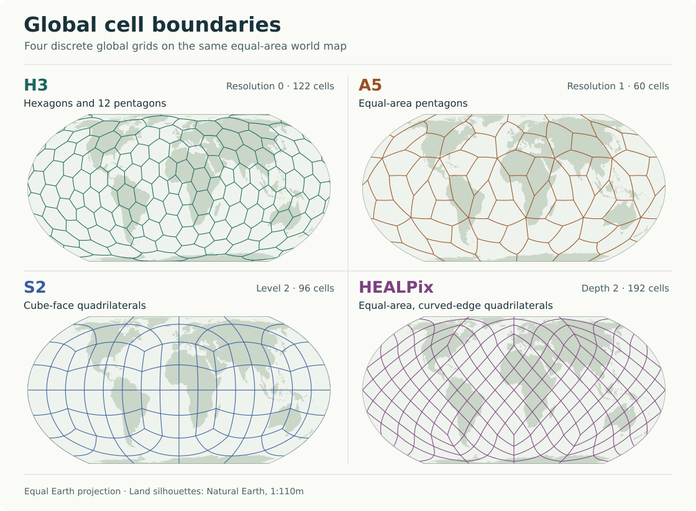
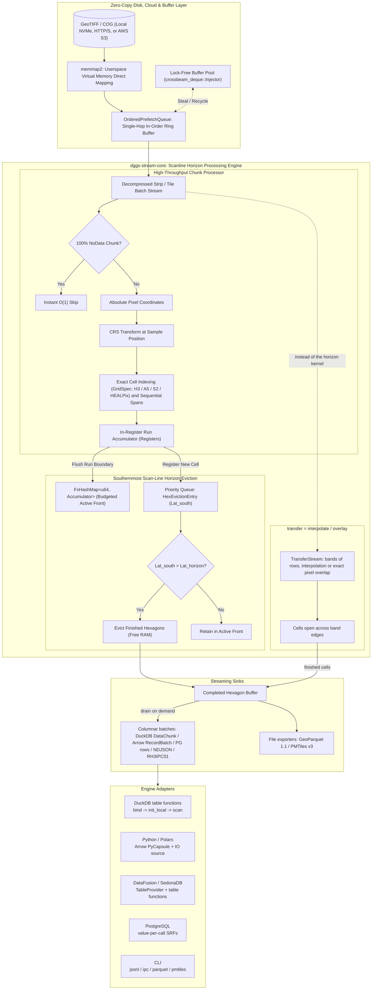

# dggs_stream: High-Performance Raster Aggregation onto Discrete Global Grids

[](https://opensource.org/licenses/MIT)
[](https://www.rust-lang.org)
[](docs/engines/duckdb.md)
[](docs/engines/python-polars.md)
[](docs/engines/postgresql.md)

A pure-Rust engine that streams multi-gigabyte geospatial raster files (GeoTIFF, Cloud-Optimized GeoTIFFs) in a single pass and aggregates them into the cells of a **Discrete Global Grid System (DGGS)**: [Uber H3](https://h3geo.org/) hexagons, [A5](https://a5geo.org/) pentagons, [Google S2](https://s2geometry.io/) cells or [HEALPix](https://healpix.sourceforge.io/) cells. It also generates cloud-native **PMTiles v3** vector pyramids for instant web visualization. Aggregation runs in a [bounded memory budget](docs/engineering.md#1-southernmost-scan-line-horizon-eviction) and spills to disk when needed. The same engine ships as a native DuckDB extension, DataFusion-style table providers, a Python/Polars package, a PostgreSQL extension and a command-line tool (see [Engines](#engines)).



Each panel shows every cell at the indicated level. Cell counts give a common reference because each grid defines its own resolution scale. [Compare grid properties](docs/grids.md).

Supports **continuous** surfaces (elevation, temperature, NDVI, precipitation) and **categorical** classifications (land cover, zoning, soil types) with dedicated streaming engines.

Default scans use pixel contributions. The Rust core also supports [ground-area overlay](docs/engines/core.md#ground-area-weighted-overlay) for integrating densities over partial pixels. It also offers [ground-area-weighted center scans](docs/engines/core.md#ground-area-weighted-center-scans) for north-up WGS84 rasters. For partial pixels, use `ground_area=True, transfer="overlay"` in Python or Polars, or `ground_area := true, transfer := 'overlay'` in DuckDB. For center assignment, use `ground_area := true` in DuckDB, `--ground-area` in CLI IPC and JSONL output, or `ground_area=True` in Python and Polars. CRS projection tolerances do not imply the same absolute WGS84 datum accuracy; NAD83 and ETRS89 paths include documented approximations. See [accuracy and weighting contracts](docs/testing.md#accuracy-and-weighting-contracts) for interpretation and regression coverage.

> **Formerly raster_h3.** See the [changelog](CHANGELOG.md#unreleased) for the new names and migration details.

| Output | Use Case | Available In |
| :--- | :--- | :--- |
| **Cell table / Arrow stream** | SQL analytics, JOINs, DataFrames | DuckDB, Python/Polars, PostgreSQL, DataFusion, CLI (NDJSON / `RH3IPC01`) |
| **PMTiles v3** | Web maps — zero servers, one file | DuckDB, Python, CLI |
| **GeoParquet 1.1** | GIS interchange (QGIS, GeoPandas, BigQuery) | DuckDB, Python, CLI |

---

A5 uses the 1.0 cell-ID system. Existing A5 0.x data needs re-indexing or explicit ID migration before use. See [A5 index version](docs/grids.md#a5-index-version).

## 📖 Table of Contents

- [Motivation & Project Goals](#motivation--project-goals)
  - [Choosing a grid](#choosing-a-grid)
- [How It Works](#how-it-works)
- [Engines](#engines)
- [Core Engineering Architecture](#core-engineering-architecture)
- [Architecture Diagram](#architecture-diagram)
- [Core Dependencies](#core-dependencies--architectural-contributions)
- [Troubleshooting & Common Pitfalls](#troubleshooting--common-pitfalls)
- [Building & Testing Locally](#building--testing-locally)
- [Deep Dives](#-deep-dives)
- [License](#license)

---

## Motivation & Project Goals

### The Problem: The Raster-Tabular Divide

Geospatial data exists in two incompatible formats:

1. **Tabular / Vector Data**: Points, polygons, GPS traces, and demographic records in relational databases (DuckDB, Snowflake, BigQuery, PostgreSQL).
2. **Raster Grids**: 2D pixel matrices in GeoTIFF files — satellite imagery, elevation models, climate grids, land cover maps.

Joining raster values (elevation, temperature, land cover) with business entities (customers, routes, parcels) has traditionally required complex, slow, memory-intensive ETL pipelines.

### The Solution: Discrete Global Grid Systems

A **Discrete Global Grid System** divides the whole Earth into cells at a series of resolutions, from continent-sized down to centimetres, and gives every cell a compact integer id. Raster pixels and vector features can both be expressed as cells, so the grid becomes a shared key between them.

Aggregating rasters into DGGS cells solves four fundamental challenges of working with raw imagery:
* **Normalizes Disparate Resolutions & Projections**: Rasters arrive with differing pixel sizes (10m Sentinel, 30m Landsat, 1km climate grids) and incompatible local projections. A global grid maps them all onto one standard set of cells without manual resampling.
* **Drastic 50×–100× Data Reduction**: A cell of about 0.7 km² (H3 resolution 8, for example) aggregates roughly 800 thirty-meter pixels into a single summary row, shrinking a multi-gigabyte raster by orders of magnitude on disk.
* **Preserves Rich Surface Distributions**: Rather than losing nuance to a simple average, the engine captures the full distribution per cell—including mean, variance/ruggedness, and min/max for continuous terrain, plus class purity and Shannon entropy (landscape fragmentation) for categorical maps.
* **Unlocks Relational Joins**: Every cell is addressed by a 64-bit integer (`UBIGINT` / `UInt64` / hex string). Once pixels become cells, rigid 2D raster matrices become standard relational tables joinable directly with tabular business data: `JOIN ON r.h3_index = v.h3_index` (or `a5_index`, `s2_index`, `healpix_index`).

### Choosing a grid

Every engine supports all four grids, so the choice depends on the question, not the engine. Changing grids changes one argument (`grid := 's2'` in SQL, `grid="s2"` in Python, `--grid s2` on the CLI) and the name of the cell column.

| | H3 | A5 | S2 | HEALPix |
| :--- | :--- | :--- | :--- | :--- |
| **Cell shape** | Hexagon (plus 12 pentagons per resolution) | Pentagon | Quadrilateral on a cube face | Quadrilateral ("diamond") |
| **Resolutions** | 0–15 | 0–30 | 0–30 | 0–29 |
| **Equal area** | No: cell area varies by about 2× across the globe | Yes, exactly | No: about 2.1× | Yes, exactly |
| **Children tile the parent** | Approximately (7 children) | No: the parent overlaps its children but doesn't cover them exactly | Exactly (4 children) | Exactly (4 children) |
| **Neighbours** | 6, all the same distance away | 5 sharing an edge | 4 sharing an edge, 4 sharing a corner | 4 sharing an edge, 4 sharing a corner |
| **Best known for** | Wide tool support, neighbourhood and movement analysis | Unbiased area totals | Region coverings, exact roll-ups, Hilbert-curve ordering | Latitude rings, global science (astronomy, climate) |

**Which one should I use?**

- **H3: the default.** Use it when you'll join with data that is already H3-indexed, since Databricks, Snowflake, Apache Sedona and DuckDB's `h3` extension all speak it. Use it too when neighbours matter, such as distance bands, flows or "the cells around this one", because all six neighbours are the same distance away.
- **A5: totals and densities that must be unbiased.** Hectares of forest, people per km², tonnes of carbon. Every cell at a resolution has the same area, so a cell count times one constant is an area and maps of per-cell values aren't skewed by cell size. Rolling A5 cells up to a parent is approximate, as it is with H3.
- **S2: exact hierarchies and region coverings.** Fine cells roll up into coarse ones with no gaps or overlaps, and cell ids follow a Hilbert curve, so a region becomes a few contiguous id ranges. Cell area varies about 2.1×, so it isn't the grid for area totals.
- **HEALPix: global and latitude-dependent analysis.** Cells are equal-area and arranged in rings of constant latitude, which makes zonal (latitude-band) averages exact and suits whole-globe climate and astronomy data. It also nests exactly. Cells are less compact near the poles and toward the corners of its base cells.

**Picking a resolution.** Aim for cells a little larger than the raster's pixels; much smaller cells come back empty. `resolutions := 'auto'` in DuckDB (Python `resolutions="auto"`, CLI `-r auto`) picks the resolution whose cells are closest in area to the pixels, and `auto+1` / `auto-1` step finer or coarser.

[Worked Examples](docs/worked-examples.md) shows each grid on a question that suits it. For the grids' own documentation, see [H3](https://h3geo.org/docs/), [A5](https://a5geo.org/), [S2](https://s2geometry.io/devguide/s2cell_hierarchy) and [HEALPix](https://healpix.sourceforge.io/).

H3 is the default, not the only choice. The same scans index pixels onto A5 equal-area
pentagons, Google S2 cells and HEALPix equal-area quadrilaterals, in every engine; `auto`
picks the resolution whose cells match the pixel size on whichever grid you choose. See
[Grids](docs/grids.md).

### Raster Meets Table: A Worked Example

A city planning department has two datasets:

1. **A land cover raster** — a 30-meter NLCD GeoTIFF classifying every pixel as forest, grassland, impervious surface, water, etc.
2. **A census demographics table** — 4,200 census tract boundary polygons (GeoJSON / GeoParquet) with total population and median income.

**The question**: *Which low-income, densely populated neighborhoods have the least tree canopy coverage?*

Without a shared spatial index, answering this requires an expensive GIS overlay: reprojecting rasters, clipping polygons, rasterizing geometries, and managing gigabytes of temporary scratch files. With dggs_stream, both datasets meet on the H3 hexagonal grid. In DuckDB:

```sql
-- Reading and polyfilling the tracts uses DuckDB's spatial extension alongside dggs_stream:
-- INSTALL spatial; LOAD spatial;

-- 1. Aggregate the 30m land cover raster into H3 hexagons (with budgeted aggregation)
CREATE TABLE canopy_h3 AS
SELECT h3_index, majority_class, majority_fraction AS canopy_purity
FROM h3_raster_categorical_aggregate(
    'nlcd_landcover_2021.tif', resolution := 8
);

-- 2. Polyfill vector census tracts into H3 cells & compute population density
-- 'covers' returns every hexagon that overlaps the tract, plus the enclosing hexagon for tracts
-- smaller than one cell, so no tract drops out (border hexagons count for both neighbours).

CREATE TABLE census_tracts_h3 AS
SELECT 
    tract_name,
    median_income,
    round(total_population / (ST_Area_Spheroid(ST_FlipCoordinates(geom)) / 1000000.0), 0) 
        AS pop_density_per_sqkm,
    unnest(h3_polygon_to_cells(ST_AsWKB(geom), 8, 'covers'))
        AS h3_index
FROM ST_Read('census_tracts.geojson');

-- 3. JOIN raster results with census tracts on the shared H3 index
SELECT
    c.tract_name,
    c.median_income,
    c.pop_density_per_sqkm,
    t.majority_class AS dominant_landcover,
    t.canopy_purity
FROM census_tracts_h3 AS c
JOIN canopy_h3 AS t 
  ON c.h3_index = t.h3_index
WHERE t.majority_class = 41          -- Deciduous forest (NLCD code)
  AND t.canopy_purity  < 0.30        -- Less than 30% tree canopy
  AND c.median_income  < 45000       -- Low-income tracts
  AND c.pop_density_per_sqkm > 3000  -- Densely populated urban neighborhoods
ORDER BY t.canopy_purity ASC;
```

DuckDB's advantage is reach: the same SQL runs from the DuckDB CLI or from Python, Node.js and
R, and one session joins the raster with vector files, Parquet and S3 data through DuckDB's
other extensions. It also exposes every engine option, including compaction and memory budgets.
Unlike SedonaDB, `WHERE` filters apply after aggregation, so narrow the scan with parameters
such as `bbox := '...'`.


#### Going further: canopy around each home

A tract-level join answers "which tracts", but a resident feels the trees on their own street.
Overture's building footprints narrow the question to *how much canopy lies within 100 m of each
home*. Each home is buffered by 100 m and the buffer is filled with resolution-11 hexagons
(about 50 m across, 2–3 NLCD pixels each): the home's own hexagon and its neighbours out to
100 m, roughly 15 cells. Each home is then scored on its own neighbourhood, not on its tract's
average.

```sql
-- Overture is read straight from S3: INSTALL httpfs; LOAD httpfs; SET s3_region = 'us-west-2';

-- 4. Forest share of every resolution-11 hexagon. In the long layout each class in a
--    hexagon is its own row; summing over all of them keeps hexagons with no forest (0).
CREATE TABLE forest_h3 AS
SELECT h3_index,
       sum(CASE WHEN category IN (41, 42, 43)     -- deciduous, evergreen, mixed forest
                THEN fraction ELSE 0 END) AS forest_share
FROM h3_raster_categorical_aggregate(
    'nlcd_landcover_2021.tif', resolution := 11, format := 'long',
    bbox := '-90.32,38.53,-90.12,38.77'          -- the city's bounding box
)
GROUP BY h3_index;

-- 5. Homes in the low-income, dense tracts, from Overture's buildings theme
CREATE TABLE homes AS
SELECT b.id, t.tract_name, b.geometry
FROM read_parquet(
    's3://overturemaps-us-west-2/release/<release>/theme=buildings/type=building/*',
    hive_partitioning = true) AS b
JOIN ST_Read('census_tracts.geojson') AS t
  ON ST_Contains(t.geom, ST_Centroid(b.geometry))
WHERE t.tract_name IN (SELECT tract_name FROM census_tracts_h3
                       WHERE median_income < 45000 AND pop_density_per_sqkm > 3000)
  AND b.subtype = 'residential'                   -- many buildings have no subtype yet
  AND b.bbox.xmin > -90.32 AND b.bbox.xmax < -90.12
  AND b.bbox.ymin >  38.53 AND b.bbox.ymax <  38.77;

-- 6. Each home's neighbourhood: buffer 100 m in metres (EPSG:5070), back to lon/lat, then
--    every resolution-11 hexagon whose centre is inside the buffer. 'contains_centroid'
--    (the default) lets edge hexagons fall in or out, so the errors roughly cancel;
--    'covers' would keep every hexagon the buffer touches and overshoot 100 m.
CREATE TABLE home_hexes AS
SELECT id, tract_name,
       unnest(h3_polygon_to_cells(ST_AsWKB(ST_Transform(
           ST_Buffer(ST_Transform(geometry, 'EPSG:4326', 'EPSG:5070', always_xy := true), 100),
           'EPSG:5070', 'EPSG:4326', always_xy := true)), 11, 'contains_centroid')) AS h3_index
FROM homes;

-- 7. Canopy near each home, then per tract. The inner join drops any hexagon that
--    no pixel centre fell in, rather than counting it as treeless.
WITH per_home AS (
    SELECT h.id, h.tract_name, avg(f.forest_share) AS canopy_near_home
    FROM home_hexes AS h
    JOIN forest_h3 AS f USING (h3_index)
    GROUP BY h.id, h.tract_name
)
SELECT tract_name,
       count(*)                                           AS homes,
       round(avg(canopy_near_home), 3)                    AS avg_canopy_near_home,
       round(avg((canopy_near_home < 0.10)::INTEGER), 2)  AS share_of_homes_under_10pct
FROM per_home
GROUP BY tract_name
ORDER BY avg_canopy_near_home;
```

The averages in step 7 count every hexagon the same; H3 cells next to each other are almost
exactly the same size, so within 100 m that is effectively area-weighted. The remaining error is
at the edge of the buffer, where a hexagon is either wholly in or wholly out. For an exact
answer, weight each hexagon by `ST_Area(ST_Intersection(cell, buffer))`; it is slower and rarely
changes the ranking. Going finer than resolution 11 doesn't help: cells smaller than NLCD's 30 m
pixels start to come back empty. The NLCD
[Tree Canopy Cover](https://www.mrlc.gov/data) product (percent canopy per pixel) is a more
direct measure than forest classes: aggregate it with `h3_raster_continuous_aggregate` and use
`mean` in place of `forest_share`.

### More worked examples

[Worked Examples](docs/worked-examples.md) pairs each engine with the grid that suits a question:

| Question | Engine | Grid |
| :--- | :--- | :--- |
| [Wetland loss inside vs. outside protected areas](docs/worked-examples.md#1-wetland-loss-inside-vs-outside-protected-areas--polars-on-a5) | Python & Polars | A5 (equal-area) |
| [Flood depth at parcels and roads](docs/worked-examples.md#2-flood-depth-at-parcels-and-roads--duckdb-on-h3) | DuckDB | H3 |
| [Snowpack per sub-basin, rolled up to the basin](docs/worked-examples.md#3-snowpack-per-sub-basin-rolled-up-to-the-basin--sedonadb-on-s2) | SedonaDB | S2 (exact nesting) |
| [Land temperature by latitude band](docs/worked-examples.md#4-land-temperature-by-latitude-band--cli-on-healpix) | CLI | HEALPix (equal-area rings) |

> No GDAL. No intermediate files. The raster *becomes* a queryable table source — a SQL table function in DuckDB, a `LazyFrame` in Polars, a table provider in SedonaDB, a file in one command from the CLI — on whichever grid fits the question.

### Why Intermediate Cell Aggregations Change Everything

Materializing both raster and vector datasets into intermediate cell tables (or Parquet files) provides fundamental architectural advantages over traditional GIS workflows:

#### 1. Benefits for Vector Datasets
* **Polyfill Once, Eliminate Geometry Math**: Administrative boundaries (census tracts, voting precincts, parcel lots) often contain thousands of vertices. Evaluating spatial containment (`ST_Contains`, `ST_Intersects`) across millions of records is computationally brutal. Polyfilling vector polygons into grid cells once eliminates all downstream polygonal math.
* **Decoupled Update Cycles**: Demographic tables, property boundaries, and customer records update frequently (daily, monthly, or annually), while foundational rasters (elevation DEMs, land cover) change rarely. Pre-indexing vectors into grid cells lets you incorporate updated vector tables with a 50ms hash join—without re-reading a 50 GB raster.
* **Standardizing Irregular Shapes (MAUP Mitigation)**: Census tracts and zip codes vary radically in area—a rural tract can be 1,000× larger than an urban one, severely distorting statistical comparisons. Polyfilling vectors into uniform cells discretizes irregular boundaries into near-equal spatial units (exactly equal-area on the A5 and HEALPix grids).

#### 2. Benefits for Raster Ingestion
* **Scan Once, Query Everywhere**: Decompressing and processing an 8–50 GB GeoTIFF (billions of pixels) is an intensive operation you only want to do once. Once aggregated into `canopy_h3` or exported to Parquet, downstream analyses query in milliseconds without touching raw raster pixels again.
* **Drastic Storage Reduction**: A multi-gigabyte raster compresses into a compact, columnar cell table that is 50×–100× smaller on disk. You can easily version-control it, store it in your cloud data lake (S3/R2), or query it from DuckDB, Polars, PostgreSQL, Snowflake, or BigQuery.

#### 3. Benefits for Spatial Joining & Visualization
* **$O(1)$ Hash Joins vs $O(N \times M)$ Geometry Math**: Converting both raster pixels and vector polygons to 64-bit integer cell ids replaces expensive topological intersection algorithms with hardware-speed **integer equality hash joins** (`JOIN ON c.h3_index = t.h3_index`).
* **Universal Lingua Franca**: Any number of disparate rasters (elevation, temperature, canopy) and vector layers (demographics, parcels, sensor points) can be joined together in a single multi-way query—eliminating projection mismatches, resolution differences, and resampling errors.
* **Direct PMTiles from Vector Parquet**: Intermediate cell tables stored in Parquet can be transcoded directly into multi-zoom web map pyramids (DuckDB `h3_parquet_to_pmtiles`) without Tippecanoe, GDAL, or GeoJSON scratch files. Zoom bands span the table's resolutions, and `COPY ... (min_zoom, max_zoom)` (Rust: `ExternalFeatureExport::with_zoom_limits`) clips the range.

### From Query to Web Map in One Step

dggs_stream can export results directly to a **PMTiles v3** single-file vector tile archive — a multi-resolution pyramid ready for MapLibre, Kepler.gl, or Felt with zero intermediate files and zero tile servers:

```bash
dggs-stream-cli pmtiles nlcd_landcover_2021.tif -c -r 5,6,7,8 -o landcover_canopy.pmtiles
```

```python
dggs_stream.raster_to_pmtiles("nlcd_landcover_2021.tif", "landcover_canopy.pmtiles", [5, 6, 7, 8], categorical=True)
```

```sql
-- DuckDB
SELECT * FROM h3_raster_to_pmtiles(
    'nlcd_landcover_2021.tif', 'landcover_canopy.pmtiles',
    min_resolution := 5, max_resolution := 8, categorical := true
);
```

```rust
// Rust: tile your own cell features. The grid is explicit (H3, A5, S2 or HEALPix).
use dggs_stream_core::pmtiles::{CellFeature, MvtValue, PmtilesTiler};
use dggs_stream_core::GridKind;

let features = cells.iter().map(|&(cell_id, canopy)| {
    CellFeature::new(cell_id, vec![("canopy", MvtValue::Double(canopy))])
});
let summary = PmtilesTiler::export_features(GridKind::H3, features, "canopy.pmtiles")?;
```

Upload `landcover_canopy.pmtiles` to S3, R2, or GitHub Pages, open it in MapLibre GL JS, and zoom from state level to city block.

A web map needs tiles at every zoom level — from hemispheric overview down to street-level detail. dggs_stream builds this entire multi-resolution pyramid in a single pass over the raster, aggregating pixels simultaneously across all requested H3 resolutions. See [PMTiles & Multi-Resolution](docs/pmtiles.md) for the full deep dive.

### Design Principles

| Principle | What It Means |
| :--- | :--- |
| **Pure Rust, Zero C++ Dependencies** | No GDAL, PROJ or Python runtime; each engine ships as one native library or binary |
| **One Core, Many Engines** | DuckDB, DataFusion, Python/Polars, PostgreSQL and the CLI all drive the same streamers and return the same cells |
| **Budgeted aggregation** | Configurable accumulator budget with disk spilling; total RAM also includes decoding and prefetch buffers |
| **Multi-Core Throughput** | Raster chunks aggregated in parallel windows across CPU cores |
| **Native PMTiles v3 Export** | Single-file web maps — zero Tippecanoe, zero tile servers |
| **Native GeoParquet 1.1 Export** | Stack-allocated WKB polygons with PROJJSON metadata |
| **Cloud-Native Streaming** | HTTP/S3 COG range prefetching — no local copies needed |
| **Sub-Pixel Super-Sampling** | RGSS, Hex, Gaussian, 8-Rooks boundary anti-aliasing |
| **Four Grids, One Pipeline** | H3, A5, S2 and HEALPix behind one `GridSpec` table, in every engine ([Grids](docs/grids.md)) |
| **Choice of Pixel Transfer** | Pixel-centre assignment, interpolation at cell centres for fine cells, or exact area overlay; per-cell histograms, NoData emission, rounding and an opt-in runtime profile ([Scan Options](docs/scan-options.md)) |

Built-in HTTP/S3 reads pin strong ETags per URL and use `If-Match`, failing if the
object changes during a scan. Rust `HttpTransport` clones share each URL's pin:
changing `url` selects an independent validator, and returning to a previous URL
retains its original pin. Servers with weak or missing ETags have no snapshot
guarantee; use immutable/versioned URLs. A server that ignores `Range` sends the
whole file into memory, so such downloads are capped at 1 GiB; raise the cap with
`DGGS_STREAM_MAX_FULL_BODY_BYTES`. See [remote COG streaming](docs/engines/core.md#remote-cog-prefetching).

---

## How It Works

dggs_stream reads a raster like a document scanner: one strip at a time, from north to south.

- **Finished cells leave early.** Once the scan has passed a cell's southern
  edge, no later row can touch it, so its statistics are final and it is sent on and
  freed. Memory holds only the band of cells under the scanner, not the whole raster.
- **Results stream into your tool.** Cells arrive in DuckDB, Polars, PostgreSQL,
  DataFusion or the CLI as they finish, so joins and exports can start before the raster
  is fully read, and a `LIMIT` can stop the scan early.
- **Memory stays within a budget.** If the active cells outgrow the aggregation
  budget (64 MiB by default), partial results spill to temporary files on disk and are
  merged at the end.
- **Some inputs wait for the end.** After a spill, and for projections whose chunk bounds
  can't be certified (many PROJ-string projections, Albers chunks near the cone apex), the scanner
  can't prove a cell is finished, so cells are held until the whole file is read.
  See [Bounding boxes and pruning](docs/crs-and-projection.md#bounding-boxes-and-pruning)
  for which projections are certified.
- **One pass, every resolution.** Each pixel is located once and counted at every
  requested resolution, which is how a multi-zoom PMTiles pyramid comes from a
  single read.
- **Fine cells and partial pixels.** For cells finer than the pixels, `transfer=interpolate`
  interpolates a value at each cell's centre; for exact area weighting, `transfer=overlay`
  splits each pixel across the cells it overlaps. Both stream the raster in bands of rows.
  Rust, CLI, DuckDB, and Python/Polars overlay scans can filter cells by the fraction of their selected overlap with valid data.
  In Rust, setting `aggregation_workers` to two or more also clips fine-resolution overlay cells in parallel ([details](docs/transfer-modes.md#parallel-overlap-calculation)).
  See [Scan Options](docs/scan-options.md).

See [Core Engineering Architecture](#core-engineering-architecture) for how each step is
implemented.

---

## Engines

The repository is a Cargo workspace: `dggs-stream-core` does all decoding, reprojection,
aggregation and export, and each engine crate is a thin adapter over it, so every engine
returns the same cells and statistics for the same input.

| Engine | Crate | Get it | Docs |
| :--- | :--- | :--- | :--- |
| **DuckDB** | `dggs-stream-duckdb` | Pre-built `.duckdb_extension` from [Releases](https://github.com/dmuldrew/dggs_stream/releases), Docker, or `cargo build --release` → `libdggs_stream.{so,dylib,dll}` | [DuckDB deep dive](docs/engines/duckdb.md) · [SQL API Reference](docs/sql-api-reference.md) |
| **Python / Polars** | `dggs-stream-python` | `pip install ./crates/dggs-stream-python` (wheels are built in CI; not yet on PyPI) | [Python & Polars](docs/engines/python-polars.md) · [Polars API Reference](docs/polars-api-reference.md) |
| **PostgreSQL 13–18** | `dggs-stream-pg` | `cargo build -p dggs-stream-pg --features pg-extension` | [PostgreSQL](docs/engines/postgresql.md) |
| **Apache DataFusion / SedonaDB** | `dggs-stream-sedona` | Cargo dependency (DataFusion pinned to SedonaDB's version); SedonaDB Python: `maturin build` in `crates/dggs-stream-sedona/python` | [DataFusion & SedonaDB](docs/engines/datafusion.md#using-with-apache-datafusion-and-sedonadb) |
| **Apache Spark / Apache Sedona** | `dggs-stream-python` (on every executor) | The `dggs-stream` wheel (`dggs_stream.spark` data source on Spark 4.0+); or `docker compose up --build sedona` (Apache Sedona 1.9.1, Spark 4.0) | [Spark & Apache Sedona](docs/engines/spark.md) |
| **CLI** | `dggs-stream-cli` | `cargo build --release -p dggs-stream-cli` (also in the Python wheel) | [CLI](docs/engines/cli.md) |
| **Rust library** | `dggs-stream-core` | Cargo dependency | [Core Engine](docs/engines/core.md) |

**Grids.** Every engine indexes pixels onto Uber H3 hexagons (resolutions 0–15, the default), A5
pentagons (0–30), Google S2 cells (levels 0–30, 64-bit cell ids) and HEALPix
cells (nested scheme, depths 0–29, NUNIQ ids `4 * 4^depth + pixel`); see [Choosing a grid](#choosing-a-grid). Each grid has its own
SQL functions (`s2_raster_continuous_aggregate`, `healpix_lonlat_to_cell`, ...; or
`grid := 's2'` on the H3 ones) and output columns (`s2_index`, `s2_hex`); the CLI takes
`--grid h3|a5|s2|healpix`, Python and SedonaDB a `grid` option, and PostgreSQL has
`{grid}_raster_*_aggregate` functions. See the [DuckDB registered functions](docs/engines/duckdb.md#registered-functions).

Feature coverage differs per engine: DuckDB exposes every parameter (sampling, bands,
spectral formulas, quantiles, remapping, budgets), DataFusion exposes most of them through
builders, and Python exposes center-scan aggregation and decode budgets and pushes Polars
filters into the engine. PostgreSQL and the CLI expose the common subset (resolutions, CRS, NoData, bbox,
categorical layout). Every engine takes the grid, `auto` resolution, the NoData policy and
`decimals`; transfer modes and histograms are in every engine except PostgreSQL, and the
runtime profile in all but PostgreSQL ([Scan Options](docs/scan-options.md#option-names-by-engine)).
The [Engines Overview](docs/engines/README.md) has the
full capability matrix, shared output schemas, a side-by-side cheat sheet and the
cross-engine parity tests. Each engine deep dive covers install, recipes (basic and
advanced scans, scalar helpers, joins, exports, remote COGs, mosaics, categorical queries),
internals and troubleshooting.

### Quick Start

**DuckDB**

```sql
LOAD 'target/release/libdggs_stream.dylib'; -- or INSTALL from a release, see the DuckDB deep dive
SELECT h3_hex, mean, count
FROM h3_raster_continuous_aggregate('dem.tif', resolution := 8)
LIMIT 5;

-- Polyfill a WKB polygon: list of UBIGINT cells; containment defaults to 'contains_centroid'
SELECT h3_polygon_to_cells(ST_AsWKB(geom), 8, 'covers') AS cells FROM areas;
```

See [`h3_polygon_to_cells`](docs/sql-api-reference.md#h3_polygon_to_cells) for the containment modes
(also available in Python as `dggs_stream.h3_polygon_to_cells`).

**Python / Polars**

```python
import polars as pl
import dggs_stream

df = (dggs_stream.scan_raster("dem.tif", 8)
        .filter(pl.col("count") > 10)
        .select("h3_hex", "mean", "count")
        .collect())
```

**PostgreSQL**

```sql
CREATE EXTENSION dggs_stream;
SELECT h3_hex, mean, count FROM h3_raster_continuous_aggregate('/data/dem.tif', 8) LIMIT 5;
```

**CLI**

```bash
dggs-stream-cli jsonl dem.tif -r 8 --columns h3_hex,mean,count --limit 5
dggs-stream-cli parquet dem.tif -r 7,8 -o dem_h3.parquet
```

**Raster scans without a `SessionContext`** (`dggs_stream_sedona::scan`)

```rust
use dggs_stream_sedona::scan::{ContinuousRasterTableProvider, FilterPredicate, RasterScan};

let provider = ContinuousRasterTableProvider::try_new("dem.tif", vec![8])?;
let plan = provider.scan(Some(&[0, 2]), &[FilterPredicate::MinCount(10.0)], Some(1000))?;
for batch in plan.execute()? { /* RecordBatch with h3_index, mean */ }
```

This is the layer under the DataFusion adapter below. Call `supports_filters_pushdown` to learn
which predicates you still have to apply to the scan's rows. With compaction on, it reports every predicate `Unsupported` and the scan returns
the full compacted table; `RasterTable` (below) then leaves those `WHERE` clauses to
DataFusion. The adapter defers `LIMIT` until after all residual filters, including inexact
pushdowns. See [filter pushdown](docs/engines/datafusion.md).

**Apache DataFusion / SedonaDB**

```rust
let ctx = sedona::context::SedonaContext::new_local_interactive().await?;
dggs_stream_sedona::register_all(&ctx.ctx); // or a plain datafusion SessionContext
ctx.sql("SELECT h3_index, mean FROM h3_raster_continuous_aggregate('dem.tif', 8) WHERE count >= 10")
    .await?
    .show()
    .await?;
```

**Rust library**

```rust
use dggs_stream_core::aggregator::multi_horizon::MultiResolutionConfig;
use dggs_stream_core::columnar::ContinuousBatchReader;
use dggs_stream_core::raster::mosaic::resolve_raster_sources;

let paths = resolve_raster_sources("dem.tif")?;
let reader = ContinuousBatchReader::open(&paths, &MultiResolutionConfig::new(vec![8]), None, 2048, None)?;
```

For continuous statistics from several bands of one interleaved or band-separated TIFF, `MultiBandStreamer` shares decoding and either center assignment or pixel–cell overlap calculations and returns one accumulator per band. [Rust multi-band scans](docs/engines/core.md#multi-band-continuous-scans)

Select bands 3 and 1 with `--bands 3,1` in CLI IPC, JSONL, or Parquet output, `bands := '3,1'` in DuckDB, `'bands=3,1'` in DataFusion and SedonaDB SQL, or `scan_raster(..., bands=[3, 1])` in Python and Polars. DuckDB exports them with `bands` and `geoparquet := true` on each grid’s direct Parquet exporter. Python also streams these columns to GeoParquet with `raster_to_parquet(src, dst, 12, bands=[3, 1])`. The CLI can write H3 GeoParquet as a Hive dataset split by parent cell with `--partition-by-parent-res R`, so a query on one parent reads one directory ([CLI guide](docs/engines/cli.md#hive-partitioned-h3-output)). Each cell has columns such as `band_3_mean` and `band_1_count`. [DuckDB example](docs/engines/duckdb.md#multiple-bands-in-one-pass)

Continuous readers build per-cell quantile sketches only when a configured quantile
column is projected (or the full schema is requested). The schema is unchanged;
`ContinuousBatchReader::tracks_quantiles()` reports the decision, and
`columnar::quantiles_projected()` exposes the projection rule.
`aggregator::multi_horizon::QuantilePlan` evaluates projected percentiles and IQR
with one sketch sweep per cell, sharing repeated probabilities. See the
[core engine guide](docs/engines/core.md#batched-quantile-evaluation) for details.

### Partitioned scans (distributed workers)

One raster or mosaic can be split across independent workers (Spark tasks, batch jobs)
that each read a disjoint set of TIFF tiles, with results identical to a single scan:
plan the partitions from metadata, scan each one, then merge the few cells that straddle
a partition edge. Rows whose `partial_state` column is null are final; the others are
merged per cell. A continuous weighted overlay scan (`transfer="overlay"`, Python and Spark)
differs in what is partial: a cell's coverage decision needs its total covered area, so
a cell that another partition might also touch stays partial, and the rest are finalized
by their worker on H3 and WGS84 tiles; projected overlay emits only partial rows (see
[Partitioned weighted overlay](docs/engines/spark.md#partitioned-weighted-overlay)).

```python
import pyarrow as pa, pyarrow.compute as pc, dggs_stream

specs = dggs_stream.plan_partitions("dem.tif", target_chunks=256)          # driver
parts = [pa.table(dggs_stream.RasterArrowStream("dem.tif", 8, partition=s))  # workers
         for s in specs]
cells = pa.concat_tables(parts)
final = cells.filter(pc.is_null(cells["partial_state"])).drop(["partial_state"])
merged = dggs_stream.merge_partials(cells.filter(pc.is_valid(cells["partial_state"])))
```

The SQL engines merge with an aggregate, so a `GROUP BY` gathers each cell's partial rows:

```sql
-- DuckDB (SedonaDB SQL is the same, with the spec as a string argument)
SELECT spec FROM h3_raster_plan_partitions('dem.tif', target_chunks := 256);
SELECT * FROM h3_raster_continuous_aggregate('dem.tif', resolution := 8, partition := '<spec>');
SELECT h3_index, resolution, h3_merge_partials(partial_state) AS cell
FROM partial_rows GROUP BY h3_index, resolution;   -- cell.mean, cell.count, ...
```

From a shell, `dggs-stream-cli plan` / `ipc --partition` / `merge` fan out with `xargs -P`
or batch jobs ([CLI guide](docs/engines/cli.md#partitioned-scans)).

In Rust the same steps are `plan_partitions`, `MultiResolutionConfig::partition` and
`PartialMerger` (DataFusion providers: `plan_partitions` / `with_partition`). See
[Partitioned scans](docs/engines/core.md#partitioned-scans) and the
[Python](docs/engines/python-polars.md#partitioned-scans-spark-and-other-distributed-engines),
[Spark & Apache Sedona](docs/engines/spark.md),
[DuckDB](docs/engines/duckdb.md#partitioned-scans) and
[DataFusion / SedonaDB](docs/engines/datafusion.md#partitioned-scans) guides.

---

## Core Engineering Architecture

dggs_stream's throughput and memory profile come from seven principles, shared by every engine:

| # | Engineering Pillar | Impact |
| :---: | :--- | :--- |
| 1 | **Southernmost Scan-Line Horizon Eviction** | Bounded aggregation memory: cells are emitted as soon as they are certified complete; disk spilling otherwise |
| 2 | **Sequential H3 Spans & In-Register Run Accumulation** | One H3 lookup per pixel, but ~98% fewer hash table updates: equal-cell runs accumulate in registers and flush once |
| 3 | **ROI Bounding Box Chunk Pruning** | Non-intersecting chunks skipped before any read or decompression, for CRSs with certified bounds, including EPSG:3413/3031 polar grids ([details](docs/crs-and-projection.md#bounding-boxes-and-pruning)) |
| 4 | **Work-Stealing Parallelism** | Rayon kernel windows in every engine, which also compute each new cell's eviction key so the serial merge stays short ([measurements](docs/worker-scaling.md)); DuckDB additionally scans with one `init_local` state per thread |
| 5 | **Bounded Prefetch & Decode Pipeline** | `memmap2` zero-copy reads, parallel decompression into a single-hop in-order ring, and recycled buffers under `decode_budget_bytes` |
| 6 | **Coalesced Cloud Range Reads** | Adjacent COG/S3 tile ranges merged into single HTTP requests and prefetched ahead of the decoders |
| 7 | **Exact CRS Transformation with Analytical Fast Paths** | Every sample transformed at its true position; identity and analytical Web Mercator/Albers paths skip Proj4 and supply the certified bounds that pruning and eviction rely on |

> 📖 **Detailed explanations** of each architectural pillar — See [docs/engineering.md](docs/engineering.md)  
> 🗺️ **Source Module Architecture** — File-by-file breakdown of crate internals mapped to these principles: [docs/module-architecture.md](docs/module-architecture.md)

---

## Architecture Diagram



> 🗺️ **Looking for source file responsibilities?** See the complete [Source Module Architecture](docs/module-architecture.md) for a guide to every file in the workspace.

---

## Core Dependencies & Architectural Contributions

Version requirements live in [Cargo.toml](Cargo.toml); resolved versions live in [Cargo.lock](Cargo.lock).

| Dependency | Purpose | Contribution |
| :--- | :--- | :--- |
| [`h3o`](https://crates.io/crates/h3o) | Pure-Rust H3 Engine | 100% Rust H3 DGGS — no C/C++ FFI overhead |
| [`memmap2`](https://crates.io/crates/memmap2) | Virtual Memory I/O | Zero-copy GeoTIFF mapping with sequential readahead |
| [`crossbeam-deque`](https://crates.io/crates/crossbeam-deque) | Lock-Free Buffer Pool | Concurrent work-stealing buffer recycling |
| [`libdeflater`](https://crates.io/crates/libdeflater) | SIMD Deflate | Hardware-accelerated decompression (AVX-512, NEON) |
| [`weezl`](https://crates.io/crates/weezl) | LZW Decoder | Fast streaming LZW for legacy GeoTIFFs |
| [`parquet`](https://crates.io/crates/parquet) | GeoParquet Engine | Streaming row-group writer with OGC GeoParquet 1.1 |
| [`tiff`](https://crates.io/crates/tiff) | GeoTIFF Decoder | Baseline TIFF, tiled TIFF, and BigTIFF support |
| [`proj4rs`](https://crates.io/crates/proj4rs) | Geodetic Reprojection | Pure-Rust PROJ.4 (UTM, Lambert, Albers → WGS84) |
| [`rustc-hash`](https://crates.io/crates/rustc-hash) | Fast Hasher | Maintained Fx hashing for numeric H3 cell keys (not a cryptographic hasher) |
| [`rayon`](https://crates.io/crates/rayon) | Work-Stealing Parallelism | Lock-free data parallelism across CPU cores |
| [`flate2`](https://crates.io/crates/flate2) | Tile Compression | Gzip for MVT payloads and PMTiles directories |
| [`thiserror`](https://crates.io/crates/thiserror) & [`serde`](https://crates.io/crates/serde) | Error & Serialization | Typed error propagation and JSON formatting |

---

## Troubleshooting & Common Pitfalls

Decoded TIFF chunks with invalid dimensions, overflowed layouts, or truncated source/destination
buffers return an error before sample unpacking rather than indexing unchecked layouts.

These apply to every engine. Engine-specific issues (DuckDB unsigned extensions, the
Python native library path, PostgreSQL privileges and version mismatches) are in each
deep dive's troubleshooting section: [DuckDB](docs/engines/duckdb.md#troubleshooting),
[Python](docs/engines/python-polars.md#troubleshooting),
[PostgreSQL](docs/engines/postgresql.md#troubleshooting).

### Missing or Non-Standard CRS

If a GeoTIFF lacks embedded projection tags, dggs_stream halts with:
```
CRS transformation error: No CRS detected in raster metadata. A CRS must be specified explicitly.
```

This prevents silent spatial corruption — meter-based coordinates treated as degrees would place hexagons in the wrong location. Specify the CRS explicitly:

| Engine | Override |
| :--- | :--- |
| DuckDB | `h3_raster_continuous_aggregate('grid.tif', resolution := 8, source_crs := 'EPSG:32610')` |
| Python | `dggs_stream.scan_raster("grid.tif", 8, crs="EPSG:32610")` |
| PostgreSQL | `h3_raster_continuous_aggregate('/data/grid.tif', 8, source_crs => 'EPSG:32610')` |
| CLI | `dggs-stream-cli jsonl grid.tif -r 8 --crs EPSG:32610` |
| DataFusion | `ContinuousRasterTableProvider::try_new("grid.tif", vec![8])?.with_crs("EPSG:32610")` |

Valid pixels whose transform fails or lands outside the valid latitude/longitude range are dropped rather than aborting the stream; they are counted by `transform_failures()` (core streamers and batch readers) and reported by the engines: a `transform_failures` column in DuckDB's export summaries, a PostgreSQL `WARNING`, a Python `RuntimeWarning` from the exporters and `scan_raster`, and a CLI warning on stderr. DuckDB (`strict_transforms := true`), Python (`strict_transforms=True`) and DataFusion (`with_strict_transforms(true)`) can fail the query instead. See [transform-failure diagnostics](docs/engines/core.md#transform-failure-diagnostics).

For supported projection families, see [Supported CRS](docs/crs-and-projection.md). Helmert datum shifts (`+towgs84`, and built-in national grids such as `EPSG:27700` and `EPSG:28992`) are applied; grid-based shifts such as NAD27 are rejected (see [Datum Shifts](docs/crs-and-projection.md#datum-shifts)). To convert your dataset into zero-trig native WGS84 for maximum throughput, see [Optimal Raster Format & Ingestion Speed](docs/optimal-raster-format.md).

### Scaled Values (GDAL Scale/Offset) and Alpha

Bands that carry GDAL `SCALE`/`OFFSET` metadata (packed reflectance, temperatures) are
aggregated as physical values, `stored * scale + offset`, including quantiles and spectral
indices. NoData is matched on the stored value, categorical classes are never scaled, and
pixels whose TIFF alpha sample is `0` are excluded. Invalid scale/offset metadata (including
a zero or non-finite scale) is rejected when the file is opened, even in raw-value mode.
To aggregate stored values from files with valid metadata instead:

| Engine | Opt-out |
| :--- | :--- |
| DuckDB | `h3_raster_continuous_aggregate('lst.tif', resolution := 8, scale_offset := false)` |
| CLI | `dggs-stream-cli jsonl lst.tif -r 8 --raw-values` |
| DataFusion | `ContinuousRasterTableProvider::try_new("lst.tif", vec![8])?.with_scale_offset(false)` |

Python and PostgreSQL always calibrate. See [Band calibration and validity](docs/sql-api-reference.md#band-calibration-and-validity).

### Antimeridian Crossing

For datasets spanning ±180° longitude, dggs_stream automatically wraps coordinates. For ROI bounding box filters across the antimeridian, split into two queries (e.g., `[170.0, 180.0]` and `[-180.0, -170.0]`).

### BigTIFF & Codec Compatibility

For JPEG-compressed GeoTIFFs with three interleaved 8-bit YCbCr samples and standard full-range color parameters, bands 1, 2 and 3 are red, green and blue. Selecting bands `3,1` returns blue and red. The reader supports shared JPEG tables for local and HTTP scans.

Natively decodes TIFF 6.0 and BigTIFF (>4 GB) with: Raw, Deflate (Zlib), LZW, ZSTD, PackBits compression and `Float32/64`, `UInt8/16/32`, `Int8/16/32` pixel types. For unsupported codecs (JPEG2000, WebP, LERC), convert first:

```bash
gdal_translate -co COMPRESS=DEFLATE input.tif output.tif
```

For maximum ingestion throughput (up to 6× faster) and optimal L2 cache residency, see the recommended GDAL conversion recipes in the [Optimal Raster Format Deep Dive](docs/optimal-raster-format.md).

### Container Memory Mapping

dggs_stream uses `memmap2` for virtual memory mapping. Ensure container runtimes allow `mmap` system calls.

---

## Building & Testing Locally

### Prerequisites
- [Rust](https://rustup.rs/) (Edition 2021+, stable toolchain)
- Optional, for the engine tests that use them: [DuckDB CLI](https://duckdb.org/) 1.0.0+ on `PATH`, `python3` (with Polars/PyArrow for the Python tests), Docker (real PostgreSQL servers)

### Build
```bash
cargo build --release
```
Outputs: `target/release/libdggs_stream.dylib` (macOS) / `.so` (Linux) / `.dll` (Windows) — the DuckDB extension — and the `dggs-stream` CLI.

To build the packaged `build/release/dggs_stream.duckdb_extension` the way the DuckDB community-extensions CI does, run `git submodule update --init && make configure && make release` ([Community Extension Build](docs/engines/duckdb.md#community-extension-build)).

To package, sign and verify the extension yourself, use the `package_extension` binary:

```bash
# Append the 534-byte DuckDB metadata footer (unsigned; load with allow_unsigned_extensions)
cargo run --release --bin package_extension -- \
    -i target/release/libdggs_stream.so -o target/release/dggs_stream.duckdb_extension

# Sign with an RSA-2048 key (-k, or DUCKDB_EXTENSION_SIGNING_KEY), write DuckDB 2.0's
# .well-known/duckdb-extension-repo.json (-m) for CREATE EXTENSION REPOSITORY, and verify
cargo run --release --bin package_extension -- \
    -i target/release/libdggs_stream.so -o target/release/dggs_stream.duckdb_extension \
    -k signing_key.pem -m dist/.well-known/duckdb-extension-repo.json \
    --verify target/release/dggs_stream.duckdb_extension
```

`--help` lists every flag (`--gzip`, `--public-key`, `--platform`, `--print-platform`, …); the DuckDB deep dive covers the [signing scheme](docs/engines/duckdb.md#build-package-load) and the [trusted-repository workflow](docs/engines/duckdb.md#option-b-install-via-custom-repository).

Other workspace members build individually:

```bash
cargo build --release -p dggs-stream-cli                         # dggs-stream-cli executable
cargo build --release -p dggs-stream-python                      # libdggs_stream_python (Python ctypes library)
cargo build --release -p dggs-stream-pg --features pg-extension  # PostgreSQL module (needs pg_config or DGGS_STREAM_PG_MAJOR)
```

| Crate | Path |
| :--- | :--- |
| `dggs-stream-core` | [`crates/dggs-stream-core`](crates/dggs-stream-core) |
| `dggs-stream-duckdb` | [`crates/dggs-stream-duckdb`](crates/dggs-stream-duckdb) |
| `dggs-stream-sedona` | [`crates/dggs-stream-sedona`](crates/dggs-stream-sedona) (standalone workspace; Python bindings in `python/`) |
| `dggs-stream-python` | [`crates/dggs-stream-python`](crates/dggs-stream-python) |
| `dggs-stream-pg` | [`crates/dggs-stream-pg`](crates/dggs-stream-pg) |
| `dggs-stream-cli` | [`crates/dggs-stream-cli`](crates/dggs-stream-cli) |

### Test

See [Test Coverage](docs/testing.md) for what each suite checks and which tests are gated.

```bash
cargo test --release --workspace

# Cross-engine parity (core, CLI, DataFusion, Python, PostgreSQL in-process, DuckDB if on PATH)
cargo test -p dggs_stream --test it multi_engine_e2e

# Real PostgreSQL servers in Docker (DGGS_STREAM_PG_VERSIONS=14,16,18 to pick majors)
cargo test -p dggs_stream --test it pg_extension_e2e -- --ignored --nocapture

# Or in Docker
docker run --rm -v "$(pwd)":/build -w /build rust:bookworm cargo test --release --workspace
```

### Profilers & Examples
```bash
cargo run --release --example benchmark_bottleneck path/to/raster.tif
cargo run --release --example benchmark_scaling
cargo run --release -p dggs-stream-core --example worker_scaling -- --quick  # kernel vs. serial-merge time per worker count
cargo run --release --example raster_to_pmtiles -- --input data/sample_sf.tif --output data/sample_sf.pmtiles
cargo run --release --example benchmark_grids -- --h3-res 8,10 --runs 3  # time and peak RSS per grid (Hawaii rasters in data/)
```

---

## 📖 Deep Dives

Topic guides that apply to every engine. Engine-specific documentation is listed under
[Engines](#engines).

| Document | What It Covers |
| :--- | :--- |
| [Grids](docs/grids.md) | H3, A5, S2 and HEALPix: resolutions, cell ids per engine, `GridSpec`, `auto` resolution, poles, polygon fill |
| [Scan Options](docs/scan-options.md) | Transfer modes (`assign_centers`, `interpolate`, `overlay`), histograms, NoData policy, rounding, runtime profile, and each engine's names for them |
| [Engineering Architecture](docs/engineering.md) | Streaming, memory budgets, disk spilling, and throughput |
| [Module Architecture](docs/module-architecture.md) | File-by-file source code map with GitHub links |
| [PMTiles & Multi-Resolution](docs/pmtiles.md) | Multi-resolution pyramids, zoom mapping, zero-server web maps |
| [Optimal Raster Formats](docs/optimal-raster-format.md) | Why tiled WGS84 COGs are 4.5–6× faster, GDAL recipes |
| [Worked Examples](docs/worked-examples.md) | One question per engine and grid: A5 wetland totals, H3 flood exposure, S2 snowpack roll-ups, HEALPix latitude bands |
| [Transfer Modes](docs/transfer-modes.md) | Centre assignment, interpolation at cell centres (nearest, bilinear, bicubic, Lanczos), area-weighted and mass-preserving overlay |
| [Super-Sampling](docs/super-sampling.md) | RGSS, Hex, Gaussian boundary anti-aliasing presets |
| [CRS & Projections](docs/crs-and-projection.md) | Supported projections, detection, 3-tier transform hierarchy |
| [Architecture Comparison](docs/architecture-comparison.md) | Benchmarks vs Python/PostGIS/GDAL, environment trade-offs |
| [Test Coverage](docs/testing.md) | Every test suite grouped by category (geodetic, threading, eviction, codecs, engines…), gated tests, CI coverage |

---

## License

This project is licensed under the [MIT License](LICENSE).
