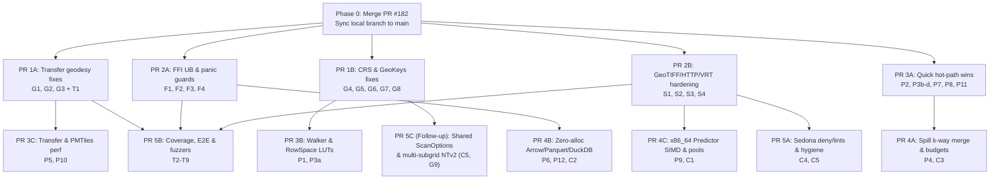

# Codebase Audit & Suggested Implementation Plan

[← Back to README](../README.md) · [Core Engineering](engineering.md) · [CRS & Projection](crs-and-projection.md) · [Testing](testing.md) · [Architecture Evolution](architecture-evolution.md)

> [!NOTE]
> **Audit baseline:** `origin/main` at commit `f2da00f` (*Merge pull request #181 — Compact categorical accumulator*), cross-checked against open PR [#182](https://github.com/dmuldrew/dggs_stream/pull/182) (`7dbfbb6`).
> Findings exclude optimizations and fixes already landed on `origin/main` (e.g., thin LTO, runtime x86_64 FMA kernels, Snyder/Chebyshev `AlbersConicFast`, row-keyed Albers eviction, pipelined kernel windows, parallel eviction keys, ZSTD decoding in #178, compact 4-slot `CategoricalAccumulator` in #181, and the S2 polar base-cell fix in `a1735e1`).

---

## Executive Summary

`dggs_stream` already has a strong engineering foundation: mathematically certified horizon eviction, rigorous Helmert/Position Vector datum conventions, counting-allocator memory tests, Miri/TSan/libFuzzer gates, and `cargo-deny` checks. This audit identified **39 verified, still-open items** across four domains:

| Domain | Critical / High | Medium / Low | Highest-Leverage Takeaways |
| :--- | :---: | :---: | :--- |
| **Geodetic Correctness** | 5 | 4 | Global 360° rasters lose a ~13.5° longitude strip in `transfer` (`interpolate`/`overlay`); GeoTIFF `extract_crs` can silently fall back to WGS84 on projected/geocentric files; `AlbersConicFast` can bypass explicit ellipsoid overrides and clamp out-of-domain points to ±90°. |
| **Security & FFI Safety** | 7 | 4 | Unbounded GeoTIFF chunk/sparse allocations bypass `DecodeBudget`; `s3://` bucket URL injection & overbroad `AWS_SESSION_TOKEN` forwarding; `.vrt` path traversal/SSRF; FFI UB in Arrow C (`import_histogram`), DuckDB (`*const bool`), PostgreSQL (`longjmp` over `Drop`), and Python (`ctypes.pythonapi` mutation). |
| **Performance & Memory** | 6 | 6 | Missing `all_valid` Pass 2 SIMD fast-path for NoData-tagged rasters; double per-pixel evaluation in `walker.rs`; expensive per-cell trig/probes in `RowSpace::cell_keys` & `push_eviction`; spill write amplification & equal multi-res budgets; per-chunk TIFF decoder re-open in `transfer/`; 74M–149M per-row heap allocs in Arrow/Parquet. |
| **Test & CI Coverage** | 5 | 4 | `transfer/` lacks mosaic/antimeridian/global/polar tests; zero BigTIFF / BigEndian / `I8`/`I32`/`I64`/`U32`/`U64` GeoTIFF E2E tests; newer DuckDB features tested only on Unix mock FFI; `dggs-stream-sedona` omitted from `cargo-deny`, `[workspace.lints]`, and coverage; CI runs `--release` only (no `debug_assert!`). |

---

## 0. Open Pull Request Review

There is **1 open PR** at the time of this audit:

- **[#182 — Land the ContinuousAccumulator, cell ID hasher and PMTiles cell_id renames on main](https://github.com/dmuldrew/dggs_stream/pull/182)** (`claude/modest-ramanujan-xnp3ju` → `main`, commit `7dbfbb6`)
  - **Scope:** Re-lands #177 (`H3Accumulator` → `ContinuousAccumulator`), #179 (`H3BuildHasher`/`H3Hasher`/`mix_h3` → `CellIdBuildHasher`/`CellIdHasher`/`mix_cell_id`), and #180 (PMTiles `FeatureProperties::cell_id`), which had merged into stacked branches rather than `main`.
  - **Verification:** Zero leftover references to the old symbols outside historical `CHANGELOG.md` entries. Merge-conflict resolutions in `CHANGELOG.md` and `docs/engines/core.md` preserve #181's categorical worker-sizing documentation alongside the renames.
  - **Status:** `MERGEABLE`; all test, fuzz, Miri, TSan, and wheel jobs green (3 packaging builds finishing). Devin Review's sole comment (README update) was rightly resolved because the README never referenced `H3Accumulator`.
  - **Action:** Merge #182 first (Phase 0) before starting any implementation PRs below.

---

## 1. Detailed Audit Findings

### 1.1 Geodetic & Spatial Correctness

**Verified sound (not flagged):** `eviction_north_bound` & `RowSpace` Albers eviction bounds, `compute_cell_south_lat_for` spherical Lipschitz lower bound, `HierarchicalCompactor` aperture-7 child/pentagon non-containment handling, Helmert Position Vector signs (`27700`, `28992`, `31466–31469`, `23028–23038`), `GTRasterTypeGeoKey` `PixelIsPoint` shifts, exact ellipsoidal `wgs84_rectangle_area`, WKB CCW winding & antimeridian splitting, MVT `orient_exterior`, and Sedona `Inexact` bbox widening.

| ID | Severity | Location (`origin/main`) | Finding & Root Cause |
| :--- | :---: | :--- | :--- |
| **G1** | **High** | [`transfer/stream.rs:707-765`](../crates/dggs-stream-core/src/transfer/stream.rs#L707-L765) | **`block_bbox` drops a ~13.5° longitude strip on every 360°-wide global raster.** Edge probes compute `(lon - centre_lon + 540.0).rem_euclid(360.0) - 180.0` at `STEPS = 8`. On any global block (`[-180, 180]` or `[0, 360]`), the eastern edge `c1` (`+180°` from center) wraps to `-180°`, giving `west = -180`, `east = +135`, `east - west = 315 < 359` (`full_lon = false`). With 5% padding (`15.75°`), `(east - west) + 2*pad_lon = 346.5° < 360°`, returning `[+164.25, south, +150.75, north]` and silently dropping all cells in `(+150.75°, +164.25°)` in `interpolate` (all res) and `overlay` (H3 res ≥ 5). Because `plan_tile` sets `cols = width` for `overlay`, **every global raster hits this**. |
| **G2** | **High** | [`transfer/stream.rs:878-949`](../crates/dggs-stream-core/src/transfer/stream.rs#L878-L949) | **Antimeridian, polar, and rotated-raster defects in `cell_polygon_in_pixels` and `to_pixel`.** (1) `geographic` checks only `Wgs84Identity`; non-WGS84 cylindrical CRSs (`EPSG:3857`, `EPSG:6933`, `+proj=eqc`/`merc`/`cea`) fail to unwrap antimeridian polygons (stretching cells across the full world width) and skip the `interior_pole` fallback in `EPSG:6933`/`+proj=eqc`. (2) On global `[-180, 180]` WGS84 rasters, `cell_polygon_in_pixels` shifts the ring into at most one branch (`0` or `±turn`), never clipping both copies against `[0, width)` — dropping half of every antimeridian-straddling cell and corrupting `mass_preserve` totals. (3) For rotated/sheared WGS84 rasters (`gt.b != 0 || gt.d != 0`), `turn = (360.0 / gt.a).abs()` shifts only `col` (and `gt.a == 0` yields `inf`); `to_pixel` similarly checks only `0..width` on `first.0`. |
| **G3** | **High** | [`transfer/stream.rs:952-967`](../crates/dggs-stream-core/src/transfer/stream.rs#L952-L967) | **`last_overlapping_tile` uses uncertified `tile.bounds_wgs84`.** Reads raw `tile.bounds_wgs84` instead of `tile.crs_transformer.rejection_bounds(tile.bounds_wgs84)`. For uncertified `Proj4` CRSs (LCC `2154`, LAEA `3035`, Polar Stereographic, Sinusoidal), curved extrema can be under-reported, causing `finish_cells` to emit partial cells prematurely and duplicate cells from later tiles. |
| **G4** | **High** | [`raster/metadata.rs:394-445`](../crates/dggs-stream-core/src/raster/metadata.rs#L394-L445), [`550-560`](../crates/dggs-stream-core/src/raster/metadata.rs#L550-L560) | **`extract_crs` silently treats Projected/Geocentric GeoTIFFs as WGS84 (`EPSG:4326`) and misparses single-`UNIT` WKT1.** (1) `is_projected` checks only keys `3072` and `3075`, ignoring `GTModelTypeGeoKey (1024)` (`1 = Projected`, `3 = Geocentric`) and `ProjectionGeoKey (3074)`. A projected or geocentric TIFF lacking `3072`/`3075` (or with an unsupported WKT `PROJCS` + `2048=4326`) silently falls back to `Wgs84Identity`. (2) When `is_projected == false`, geographic overrides (`GeogTOWGS84GeoKey 2062`, non-Greenwich `GeogPrimeMeridianGeoKey 2051`, non-degree `GeogAngularUnitsGeoKey 2054`) are skipped. (3) In `parse_wkt_or_ascii_to_proj`, `upper.rfind("UNIT[")` grabs the inner `GEOGCS` `UNIT["degree", 0.0174532925199433]` if `PROJCS` omits its outer linear `UNIT[...]`, emitting `+to_meter=0.0174532925199433`. |
| **G5** | **High** | [`crs/transformer/albers.rs:188-202`](../crates/dggs-stream-core/src/crs/transformer/albers.rs#L188-L202), [`321-335`](../crates/dggs-stream-core/src/crs/transformer/albers.rs#L321-L335) | **`AlbersConicFast` ellipsoid override bypass, unwrapped longitudes, and silent out-of-domain pole clamping.** (1) `is_valid_ellipsoid` uses `||` instead of checking all supplied parameters (unlike `longlat`), so `+datum=WGS84 +a=6371000` silently ignores `+a`/`+rf` and uses hardcoded GRS80; the tolerance `(a - 6378137).abs() < 1.0 && (rf - 298.257).abs() < 0.02` is also overly loose. (2) `lon_deg` is not wrapped to `[-180, 180)`, so EPSG:3338 (Alaska Albers) returns `-187.1°` for Western Aleutian points. (3) `(q * self.inv_qp).clamp(-1.0, 1.0)` maps out-of-domain coordinates (polar exclusion circle) silently to `±90°` instead of returning `Err(CrsError)` like `proj4rs`. |
| **G6** | **Medium** | [`crs/transformer/tm.rs:112-123`](../crates/dggs-stream-core/src/crs/transformer/tm.rs#L112-L123) | **Case-sensitive sphere check in `TmCertificate`.** Checks `e == "sphere"`, whereas `proj4rs` matches case-insensitively — falsely certifying `+proj=tmerc +ellps=SPHERE`. |
| **G7** | **Medium** | [`encoding/wkb_reader.rs:81-83`](../crates/dggs-stream-core/src/encoding/wkb_reader.rs#L81-L83), [`sedona/src/spatial.rs:321-335`](../crates/dggs-stream-sedona/src/spatial.rs#L321-L335) | **Embedded EWKB SRIDs silently discarded.** Both readers skip the 4-byte SRID when `0x2000_0000` is set without rejecting non-`4326`/`0` SRIDs. |
| **G8** | **Low** | [`multi_horizon/walker.rs:790-798`](../crates/dggs-stream-core/src/aggregator/multi_horizon/walker.rs#L790-L798) | **`RowPruner` boundary mismatch at exact `lon == 180.0`.** Disables linear column pruning only on strict `row_west < -180.0 \|\| row_east > 180.0`; custom `SamplingPattern` with `dx == 1.0` on `[-180, 180]` wraps `180.0 → -180.0` in `is_point_in_bbox` while being pruned. |
| **G9** | **Low** | [`crs/ntv2.rs:139-242`](../crates/dggs-stream-core/src/crs/ntv2.rs#L139-L242) | **NTv2 standalone single-subgrid limitation.** Math matches PROJ 9.6.0, but `Ntv2Grid` is not wired into `CrsTransformer`, rejects multi-subgrid files (`NUM_FILE != 1`, blocking `NTV2_0.GSB`, `BETA2007`, `GDA94_GDA2020`, `OSTN15`), doesn't wrap input longitudes across `±180°`, and omits the trailing `END     ` record check. *(Also note: `overlay` weights by planar pixel fraction rather than ellipsoidal `m²` — document explicitly or offer an area-weighted option.)* |

---

### 1.2 Security & Untrusted-Input Robustness

| ID | Severity | Location (`origin/main`) | Finding & Risk |
| :--- | :---: | :--- | :--- |
| **S1** | **Critical** | [`raster/geotiff.rs:193-229`](../crates/dggs-stream-core/src/raster/geotiff.rs#L193-L229), [`451-565`](../crates/dggs-stream-core/src/raster/geotiff.rs#L451-L565), [`784-876`](../crates/dggs-stream-core/src/raster/geotiff.rs#L784-L876), [`1049-1196`](../crates/dggs-stream-core/src/raster/geotiff.rs#L1049-L1196), [`prefetch.rs:395`](../crates/dggs-stream-core/src/raster/prefetch.rs#L395) | **Unbounded GeoTIFF chunk allocations, decompression bombs & unchecked arithmetic.** `parse_metadata_and_layout` never caps per-chunk decoded bytes, uses truncating `as u16`/`as u8` tag casts, and inspects only `BitsPerSample[0]` (ignoring heterogeneous multi-band bit depths). Both the sparse-chunk path and `fast_decode` (Deflate/LZW/ZSTD) compute `width * height * spp * byte_len` unchecked and allocate `vec![...]` directly, bypassing `tiff::decoder::Limits` and `DecodeBudget` (which admits any single chunk larger than budget when `others == 0`). `get_chunk_payload` passes untrusted `chunk_bytes[idx]` straight to `vec![0u8; len]` (`http_range.rs:1320`). |
| **S2** | **High** | [`raster/http_range.rs:153-219`](../crates/dggs-stream-core/src/raster/http_range.rs#L153-L219), [`265-271`](../crates/dggs-stream-core/src/raster/http_range.rs#L265-L271), [`326-331`](../crates/dggs-stream-core/src/raster/http_range.rs#L326-L331), [`391-415`](../crates/dggs-stream-core/src/raster/http_range.rs#L391-L415) | **HTTP SSRF, `https→http` redirect downgrade, `s3://` bucket URL injection, & `AWS_SESSION_TOKEN` leakage.** (1) `normalize_url` skips bucket validation and `Url::parse` for `s3://`: `s3://attacker.com?/key` becomes `https://attacker.com?.s3.amazonaws.com/key`. (2) `is_s3_host` matches *any* `*.amazonaws.com` host (including third-party EC2/API Gateway/S3), forwarding `AWS_SESSION_TOKEN` in `x-amz-security-token` without SigV4 signing. (3) `redirect_target` permits `https://` → `http://` downgrades, and no connect-time block prevents loopback/RFC1918/cloud-IMDS (`169.254.169.254`) SSRF. |
| **S3** | **High** | [`raster/mosaic.rs:82-140`](../crates/dggs-stream-core/src/raster/mosaic.rs#L82-L140) | **Untrusted `.vrt` path traversal / SSRF & glob symlink-loop stack overflow.** `parse_vrt_sources` reads unbounded `.vrt` files, ignores `relativeToVRT`, allows remote URLs and `..`/absolute `<SourceFilename>` escaping the VRT directory (critical under PG `pg_read_server_files`). `collect_matching_files` follows symlinks recursively via `path.is_dir()` with no cycle detection or depth cap. |
| **S4** | **Medium** | [`raster/remote_prefetch.rs:107-116`](../crates/dggs-stream-core/src/raster/remote_prefetch.rs#L107-L116), [`pmtiles/writer.rs:43-89`](../crates/dggs-stream-core/src/pmtiles/writer.rs#L43-L89) | **Unchecked `u64` arithmetic.** `remote_prefetch.rs` computes `chunk.offset + chunk.length - 1` and `end_offset + 1` unchecked on untrusted TIFF tags; `pmtiles/writer.rs` computes `1u64 << (2 * z)` without checking `z <= 26` / `z < 32`. |

---

### 1.3 FFI & `unsafe` Soundness

| ID | Severity | Location (`origin/main`) | Finding & UB / Crash Mechanism |
| :--- | :---: | :--- | :--- |
| **F1** | **High** | [`columnar/arrow_c.rs:195-215`](../crates/dggs-stream-core/src/columnar/arrow_c.rs#L195-L215), [`372-390`](../crates/dggs-stream-core/src/columnar/arrow_c.rs#L372-L390), [`515-545`](../crates/dggs-stream-core/src/columnar/arrow_c.rs#L515-L545), [`835-935`](../crates/dggs-stream-core/src/columnar/arrow_c.rs#L835-L935), [`998-1045`](../crates/dggs-stream-core/src/columnar/arrow_c.rs#L998-L1045) | **Arrow C Interface null-pointer UB, overflows & uncaught panics.** (1) `import_histogram` computes `(*field.buffers.add(1) as *const u64).add(field_offset + first)` without checking null first (UB + SIGSEGV on null buffer with nonzero offset) and uses unchecked `+`. (2) `to_record_batch` uses unchecked offset math and constructs `RecordBatch { ... }` directly instead of `RecordBatch::try_new` (allowing mismatched column lengths). (3) `to_column_schema` calls `Vec::with_capacity` before null/bounds checks. (4) `pack_var_width` truncates `data.len() as i32`. (5) `ArrowArray::from_record_batch` in `stream_get_next` plus `release_arrow_{schema,array}`, `stream_get_schema`, and `stream_get_last_error` lack `catch_unwind`. |
| **F2** | **High** | [`duckdb/src/functions/copy_function.rs:385`](../crates/dggs-stream-duckdb/src/functions/copy_function.rs#L385), [`partition_functions.rs:375-511`](../crates/dggs-stream-duckdb/src/functions/partition_functions.rs#L375-L511), [`ffi/mod.rs:92-173`](../crates/dggs-stream-duckdb/src/ffi/mod.rs#L92-L173) | **DuckDB `*const bool` UB, incomplete panic containment & missing null checks.** (1) `*(data as *const bool).add(row as usize)` is UB if C memory holds any byte outside `{0, 1}` — must read `*(data as *const u8) != 0`. (2) `copy_function.rs` calls `copy_*_error(..., format!(...))` outside `catch_unwind`; `partition_functions.rs` (`agg_guard`, `state_destroy`) drops panic payloads outside `catch_unwind`; `ffi/mod.rs` calls `duckdb_*_set_error` outside `catch_unwind` even though `missing_api_fn` panics on null slots. (3) Missing null pointer guards in `partition_functions.rs` (`put`, `state_init`, `state_destroy`, `state_update`). |
| **F3** | **High** | [`pg/src/fmgr.rs:318-335`](../crates/dggs-stream-pg/src/fmgr.rs#L318-L335), [`944`](../crates/dggs-stream-pg/src/fmgr.rs#L944), [`1002-1065`](../crates/dggs-stream-pg/src/fmgr.rs#L1002-L1065), [`pg/src/lib.rs:989-1005`](../crates/dggs-stream-pg/src/lib.rs#L989-L1005) | **PostgreSQL `longjmp` over live Rust destructors (UB) & thread leak on `palloc` OOM.** (1) `open(&args)` allocates `Box<S>` (spawning prefetch/decode threads) *before* `palloc(size_of::<MemoryContextCallback>())` — OOM `longjmp`s out and permanently leaks `Box<S>` and its OS threads. (2) `palloc_values(&values)` runs inside `guarded(...)` (`catch_unwind`) with `Vec<Option<String>>` live on the stack, and `pstrdup` runs while `String`s are live — PG `ereport(ERROR)` `longjmp` across `catch_unwind`/`Drop` is UB. (3) `drop_srf_state` drops panic payloads outside `catch_unwind`. (4) No exported `pg_srf_free_string` for `CString::into_raw()` error strings. |
| **F4** | **Medium** | [`python/dggs_stream/__init__.py:67-445`](../crates/dggs-stream-python/python/dggs_stream/__init__.py#L67-L445), [`498-505`](../crates/dggs-stream-python/python/dggs_stream/__init__.py#L498-L505), [`725-735`](../crates/dggs-stream-python/python/dggs_stream/__init__.py#L725-L735), [`src/ffi/arrow.rs:68,179`](../crates/dggs-stream-python/src/ffi/arrow.rs#L68), [`src/ffi/scalars.rs:179-186,368-375`](../crates/dggs-stream-python/src/ffi/scalars.rs#L179-L186) | **Python global `ctypes.pythonapi` mutation, init race & unwrapped FFI drops.** (1) Mutating `ctypes.pythonapi.PyCapsule_{New,GetName,GetPointer}.{argtypes,restype}` globally can break `pyarrow`/`shapely` in the same process (replace with module-private `ctypes.PYFUNCTYPE` wrappers). (2) `_get_lib()` lacks a `threading.Lock`. (3) `_raise_if_err` lacks `try/finally` around `free_string`, and `self._ptr` is cleared before `PyCapsule_New` (leaks on failure). (4) `raster_h3_py_free_arrow_{schema,stream}` and `scalars.rs` (`opt_cstr`, `from_raw_parts` without `wkb_len <= isize::MAX`) run outside `catch_unwind_or`. |

---

### 1.4 Concurrency, Supply Chain & Architecture Hygiene

| ID | Severity | Location (`origin/main`) | Finding |
| :--- | :---: | :--- | :--- |
| **C1** | **Medium** | [`raster/prefetch.rs:624,875`](../crates/dggs-stream-core/src/raster/prefetch.rs#L624), [`remote_prefetch.rs:444,727-735`](../crates/dggs-stream-core/src/raster/remote_prefetch.rs#L444) | **Unbounded per-scan OS thread spawning & slow `Drop` join.** Every scan calls `std::thread::spawn` (panics on `EAGAIN`; scales linearly under concurrent queries / PG `PARALLEL SAFE`), and `RemoteChunkPrefetchQueue::drop` blocks on HTTP retry sleeps (`thread::sleep` up to 30s) instead of waking via a cancellation `Condvar`. |
| **C2** | **Medium** | [`duckdb/src/ffi/duckdb_fs.rs:284-298`](../crates/dggs-stream-duckdb/src/ffi/duckdb_fs.rs#L284-L298) | **Mutex held across network I/O.** `DuckDbFileTransport::read_exact_at` holds `self.pool.lock()` across `self.fs.open_read(&self.path)`, serializing concurrent `httpfs`/S3 opens. |
| **C3** | **Medium** | [`pmtiles/external_export.rs:367-385,467`](../crates/dggs-stream-core/src/pmtiles/external_export.rs#L367-L385) | **Unbounded open FDs in `ExternalFeatureExport`.** Keeps every spilled `File` open until `build()`, wrapping each in a 256 KiB `BufReader` (can hit `EMFILE` or exceed `budget_bytes`). |
| **C4** | **High** | [`.github/workflows/ci.yml:622-641`](../.github/workflows/ci.yml#L622-L641), [`security.yml:16-24`](../.github/workflows/security.yml#L16-L24), [`crates/dggs-stream-sedona/Cargo.toml`](../crates/dggs-stream-sedona/Cargo.toml), [`crates/dggs-stream-python/pyproject.toml:52`](../crates/dggs-stream-python/pyproject.toml#L52) | **Supply-chain & lint blind spot on standalone `dggs-stream-sedona` workspace.** Excluded from `cargo-deny` in both `ci.yml` and `security.yml` and defines no `[workspace.lints]` (opting out of `undocumented_unsafe_blocks`, `unsafe_op_in_unsafe_fn`, `broken_intra_doc_links`). Also `pyproject.toml:52` runs unverified `curl ... sh.rustup.rs \| sh`. |
| **C5** | **Low** | Engine `Cargo.toml`s, `args.rs`/`bind_helper.rs`/`table.rs`, [`docs/engineering.md:89,179-182`](../docs/engineering.md#L89), `scripts/pg_e2e.sh` | **Hygiene & duplication.** (1) Unused/dev-only deps (`crossbeam-deque` in duckdb, `libc`/`h3o` in pg & python, `h3o`/`flate2` in cli). (2) Strict option parsing & cross-option validation duplicated 4× across DuckDB/PG/Python/Sedona. (3) Contradictory determinism note in `docs/engineering.md` (L89 vs L179–182). (4) Hardcoded SQL extension version in `scripts/pg_e2e.sh` and unchecked `sedona` dev-dep versions in `scripts/check_versions.py`. |

---

### 1.5 Performance & Memory Optimization Opportunities

| ID | Tier | Location (`origin/main`) | Bottleneck & Expected Impact |
| :--- | :---: | :--- | :--- |
| **P1** | **Tier 1** | [`walker.rs:305-370`](../crates/dggs-stream-core/src/aggregator/multi_horizon/walker.rs#L305-L370), [`575-660`](../crates/dggs-stream-core/src/aggregator/multi_horizon/walker.rs#L575-L660), [`categorical.rs:358`](../crates/dggs-stream-core/src/aggregator/multi_horizon/categorical.rs#L358) | **Redundant per-pixel work in `walk_grid` & `SampleProjector::project`.** Computes discarded `y`, branches on `RowCache`, and bounds-checks `Vec[0]` per pixel; invokes `engine.get_sample` purely as a validity test and throws away the result, running scaling, `HistogramBins::bin_of` (binary search), or `CategoryRemapper::remap` **twice per pixel**. **Impact:** ~5–15% faster continuous walk; **20–35%+ faster** remapped/binned categorical scans. |
| **P2** | **Tier 1** | [`aggregator/simd.rs:266-456`](../crates/dggs-stream-core/src/aggregator/simd.rs#L266-L456), [`568-595`](../crates/dggs-stream-core/src/aggregator/simd.rs#L568-L595), [`768-797`](../crates/dggs-stream-core/src/aggregator/simd.rs#L768-L797) | **Missing `all_valid` branchless Pass 2 fast-path for NoData-tagged GeoTIFFs.** `accumulate_span_f32_with_nodata` (the dominant real-world path) omits the `total_count as usize == slice.len()` guard present in `_no_nodata`, executing 8 per-lane branches + redundant `v != nd` on Pass 2 and blocking LLVM SIMD. **Impact:** 1.5–2× faster Pass 2 (~30 LOC). |
| **P3** | **Tier 1** | [`eviction_space.rs:318-421`](../crates/dggs-stream-core/src/aggregator/multi_horizon/eviction_space.rs#L318-L421), [`sharded_map.rs:347-395`](../crates/dggs-stream-core/src/aggregator/multi_horizon/sharded_map.rs#L347-L395), [`pipeline.rs:273-286`](../crates/dggs-stream-core/src/aggregator/multi_horizon/controller/pipeline.rs#L273-L286) | **Per-cell eviction & shard bookkeeping overhead.** (a) `RowSpace::cell_keys` runs `cell.boundary()` + 6 haversines + 2–3× `parallel_scale` (`sin`/`cos`/`ln`/`sqrt`) per unique cell — replace with precomputed max-vertex-radius + 0.5°/1° `max_scale` LUTs (5–8× faster, ~1–2 rows slack). (b) `push_eviction` runs a redundant random-access `contains_key` probe (74M cache misses on CONUS res 10). (c) `MergeTarget::merge` scans every worker map entry for `heap_bytes()` even without quantiles. (d) `pop_completed` restarts at shard `0` on every pop. |
| **P4** | **Tier 1** | [`construct.rs:173-174`](../crates/dggs-stream-core/src/aggregator/multi_horizon/controller/construct.rs#L173-L174), [`spill.rs:121-299`](../crates/dggs-stream-core/src/aggregator/multi_horizon/spill.rs#L121-L299) | **Spill thrashing at fine/multi-res.** Equal budget split (`budget / num_res / 4`) starves fine resolutions; binary-carry 2-way merging causes $O(N \log_2 R)$ write amplification; 4 KiB `BufReader`/`BufWriter` buffers cause 16–32× excess syscalls; quantile `read_state` omits `FxHashMap` capacity pre-sizing. **Impact:** 2–5× faster spilling runs. |
| **P5** | **Tier 1** | [`transfer/window.rs:139`](../crates/dggs-stream-core/src/transfer/window.rs#L139), [`clip.rs:70-113`](../crates/dggs-stream-core/src/transfer/clip.rs#L70-L113), [`stream.rs:163`](../crates/dggs-stream-core/src/transfer/stream.rs#L163) | **`transfer/` I/O, alloc & single-thread bottlenecks.** Calls `tile.reader.read_chunk(index)` (re-opening a fresh TIFF decoder + decompressor per chunk); `pixel_overlaps` allocates 4 heap `Vec`s per cell; `pending` uses `SipHash`; blocks execute single-threaded. **Impact:** 2–5× faster local I/O (10×+ on COGs), zero per-cell allocs in clipping, near-linear multi-core scaling. |
| **P6** | **Tier 1** | [`columnar/mod.rs:263-270`](../crates/dggs-stream-core/src/columnar/mod.rs#L263-L270), [`parquet/writer.rs:229-265`](../crates/dggs-stream-core/src/parquet/writer.rs#L229-L265), [`duckdb/table_function.rs:316`](../crates/dggs-stream-duckdb/src/functions/table_function.rs#L316), [`categorical_table_function.rs:374`](../crates/dggs-stream-duckdb/src/functions/categorical_table_function.rs#L374), [`chunk_writer.rs:333`](../crates/dggs-stream-duckdb/src/functions/bind_utils/chunk_writer.rs#L333) | **Serialization & projection waste.** Per-row `String`/`Vec<u8>`/`ByteArray` allocs (74M–149M allocs on CONUS); main-thread WKB/hex encoding & missing `BYTE_STREAM_SPLIT` in Parquet; eager unprojected `stddev`/`shannon_entropy` (and double `shannon_entropy` in DuckDB categorical); per-row `duckdb_data_chunk_get_vector` C-FFI calls in `ChunkWriter`. **Impact:** 30–50% faster Parquet writes; 10–25% faster DuckDB/Arrow projection scans. |
| **P7** | **Tier 2** | [`aggregator/quantiles.rs:327-363`](../crates/dggs-stream-core/src/aggregator/quantiles.rs#L327-L363) | **Eager `exp()` per bin in `QuantileSketch::quantiles_batch`.** Computes `Self::lower_bound(key)` on every bin instead of only bins where `cum >= pending[next].0` (10–30× fewer `exp()` calls). |
| **P8** | **Tier 2** | [`multi_horizon/categorical.rs:256`](../crates/dggs-stream-core/src/aggregator/multi_horizon/categorical.rs#L256) | **`CategoricalEngine::clear_acc` deallocs overflow buffer.** Writes `*acc = CategoricalAccumulator::default()` on every run transition instead of resetting `inline_len`/`total_count` and clearing the overflow buffer in place. |
| **P9** | **Tier 2** | [`raster/predictor.rs:51-119`](../crates/dggs-stream-core/src/raster/predictor.rs#L51-L119), [`geotiff.rs:812-872`](../crates/dggs-stream-core/src/raster/geotiff.rs#L812-L872), [`prefetch.rs:905-1005`](../crates/dggs-stream-core/src/raster/prefetch.rs#L905-L1005) | **`x86_64` Predictor 2/3 SIMD, Predictor 2 direct decode & sparse COG short-circuit.** Predictor SIMD exists only on `aarch64` NEON (and omits `i8`/`i16`); Predictor 2 still copies through `decomp_scratch` (~1 MB/tile); sparse ocean COG tiles still reserve `DecodeBudget` and memset a full tile; `recycle_batch` locks/notifies per chunk instead of per batch. |
| **P10** | **Tier 2** | [`grid.rs:769-789`](../crates/dggs-stream-core/src/grid.rs#L769-L789), [`pmtiles/tiler.rs:557-726`](../crates/dggs-stream-core/src/pmtiles/tiler.rs#L557-L726), [`pyramid.rs:444-507`](../crates/dggs-stream-core/src/pmtiles/pyramid.rs#L444-L507) | **PMTiles tiler serial recomputation & allocs.** `GridKind::interior_pole` recomputes H3 pole cells uncached; main thread serially recomputes boundaries/centers in `Wgs84BoundsAccumulator::record_cell_for`; `zooms_for_grid_res` allocates `Vec<u8>` per cell; `ContinuousTiles` computes `stddev()` 3× per cell. |
| **P11** | **Tier 2** | [`multi_horizon/area_continuous.rs:82`](../crates/dggs-stream-core/src/aggregator/multi_horizon/area_continuous.rs#L82) | **Per-pixel `wgs84_pixel_area` recomputation.** Calls `wgs84_pixel_area(gt, col, row)` on every pixel even though north-up WGS84 pixel area is constant per row. |
| **P12** | **Tier 2** | [`controller/pipeline.rs:368-508`](../crates/dggs-stream-core/src/aggregator/multi_horizon/controller/pipeline.rs#L368-L508), [`lifecycle.rs:97-175`](../crates/dggs-stream-core/src/aggregator/multi_horizon/lifecycle.rs#L97-L175), [`pg/src/lib.rs`](../crates/dggs-stream-pg/src/lib.rs) | **Channel contention & AoS → SoA intermediate copies.** Replace `Arc<Mutex<mpsc::Receiver>>` + `to_vec()` key clones in `run_pipelined` with `crossbeam_deque::Injector` + pooled buffers; add direct SoA drain bypassing `OutputBuffer` when compaction is off; remove temporary `Vec` + `VecDeque` double-buffering in `PgContinuousSrf`. |

---

### 1.6 Missing Test Coverage, Fuzzing & CI Verification

| ID | Priority | Scope | Missing Verification |
| :--- | :---: | :--- | :--- |
| **T1** | **High** | `transfer/` (`interpolate`/`overlay`) | Zero tests for mosaics, antimeridian/`0..360°`, global 360° rasters (would have caught **G1**), polar cells, projected/rotated `overlay`, multi-block windowing, sparse chunks, `SCALE`/`OFFSET`, multiband, `CategoryRemapper`, multi-res, quantiles, or `strict_transforms`. |
| **T2** | **High** | GeoTIFF codecs & layouts | Zero E2E tests for BigTIFF (`0x2B`), BigEndian (`MM`), `OldDeflate` (32946), `WhiteIsZero` files, or fast-path `I8`/`I32`/`I64`/`U32`/`U64`/`F64` (`I16` appears only in `#[ignore]`d Hawaii tests). |
| **T3** | **High** | DuckDB real SQL & CI ordering | Newer features (A5/S2/HEALPix, `transfer`, `nodata_policy`, `decimals`, `histogram`, `auto`, `quantiles`, `strict_transforms`, `profile`) tested only via Unix-only non-v1.5.6 mock C-API (`ffi_sql/`), not in `duckdb_sql_smoke.rs` or Windows/DuckDB 2.0. `multi_engine_e2e.rs` silently skips DuckDB in CI because `cargo test` runs before DuckDB CLI download. |
| **T4** | **High** | Fuzzing blind spots | Missing fuzz targets for: `Ntv2Grid::read`, WKT/PROJ/GeoKeys CRS parser, VRT XML & globbing, option/spec parsers (`HistogramBins`, `ResolutionSpec`, `QuantileTarget`, `SpectralFormula`, `PartitionSpec`, `PyScanOptions` JSON), `ExternalPmtilesExporter`, HTTP URL/redirect parser. Existing `geotiff` target never decodes chunks; `predictor` only fuzzes `u16`; `partial_state` omits `AreaAccumulator`; `arrow_import` omits `Histogram`/validity bitmaps. |
| **T5** | **High** | CI debug-asserts, coverage & sanitizers | CI runs `--release` tests only (no `debug_assert!` / overflow checks). `coverage.yml` omits `dggs-stream-duckdb`, `dggs-stream-sedona`, root crate, Python `*.py`, and `--test memory`. TSan omits `sharding`, `mosaic`, `remote_cog::prefetch`, `partitioned_scan`, `duckdb/record_queue`, `pmtiles`. |
| **T6** | **Medium** | Multi-grid (A5/S2/HEALPix) & compaction | Zero streaming compaction tests for A5/S2/HEALPix or H3 pentagons; zero S2/HEALPix tests in `geoparquet.rs`, `mvt_geometry.rs`, `pmtiles.rs`, `properties.rs`, or antimeridian/South-Pole `polygon_fill`. |
| **T7** | **Medium** | PostgreSQL, SedonaDB Python, Spark, CLI | `pg_extension_e2e.rs` & `sedona-e2e` never run in CI; PG E2E only tests H3 (not A5/S2/HEALPix, `auto_resolution`, `nodata_policy`/`decimals`, `pg_read_server_files`, or upgrade scripts). `test_sedonadb.py` omits 11 implemented scan options; Spark `test_datasource.py` omits 9 options; CLI `binary.rs` omits newer flags (`--grid`, `-r auto`, `--transfer`, `--histogram`, `--profile`). |
| **T8** | **Medium** | Mosaics, HTTP COGs & NTv2/CRS | Zero tests for mixed-CRS mosaics, differing NoData across overlapping tiles, differing sample types, HTTP `416`/`429`/`500`/`502`/`504`, `Retry-After` HTTP-date, end-to-end `https→http` redirect; NTv2 tests use only a 2×2 grid; built-in EPSGs (`6933`, `7846–7859`, `28992`, `31466–31469`, `23028–23038`, `2154`, `3035`, `25828–25838`) lack full streaming horizon tests. |
| **T9** | **Low** | Memory-budget & crash-safety | `tests/memory/scenarios.rs` omits `TransferStream`, `ExternalPmtilesExporter`, `compaction_budget_bytes`, and `RemoteHttpSource` LRU eviction. No fault-injection tests for truncated/corrupt spill files during `SpillRuns::finish` or mid-write PMTiles cleanup. |

---

## 2. Suggested Phased Implementation Plan

The work is sequenced into **6 phases (13 focused PRs)** so correctness and safety land before performance refactors, every PR is independently reviewable and benchmarkable, and CI gates prevent regressions.

### Phase 0 — Baseline Alignment
- **PR #182:** Merge once the remaining packaging jobs pass. Rebase/sync local workspace to `origin/main` so all work proceeds on the `dggs-stream-*` layout.

---

### Phase 1 — Geodetic & Spatial Correctness (2 PRs)

#### PR 1A: Fix `transfer/` Global Bbox, Antimeridian/Polar/Rotated Polygons & Mosaic Bounds (`G1`, `G2`, `G3`, `T1`)
- **Changes:**
  - `crates/dggs-stream-core/src/transfer/stream.rs`:
    - Fix `block_bbox` by unwrapping edge longitudes sequentially along the perimeter (or detecting `>= 359°` longitudinal span directly from consecutive edge samples) so 360°-wide blocks always return `[-180, south, 180, north]`.
    - Fix `cell_polygon_in_pixels` & `to_pixel`: detect global/cylindrical CRSs (not just `Wgs84Identity`), emit & clip **both** `0` and `±turn` copies when an antimeridian cell straddles a global raster seam, use the inverse GeoTransform for `±360°` shifts so rotated/sheared WGS84 rasters shift both `(col, row)`, and apply the pole-interior fallback to cylindrical projections reaching `±90°` (`EPSG:6933`, `+proj=eqc`).
    - Fix `last_overlapping_tile` to use `tile.crs_transformer.rejection_bounds(tile.bounds_wgs84)` (falling open when uncertified).
- **Verification:** Add `transfer_modes.rs` tests for global `[-180, 180]` and `[0, 360]` rasters (`interpolate` + `overlay` + `mass_preserve`, verifying zero dropped cells in `(+150°, +165°)` and exact pixel conservation across ±180°), `EPSG:3857` / `EPSG:6933` antimeridian & polar rasters, rotated WGS84 `overlay`, and multi-tile `Proj4` mosaics.

#### PR 1B: Fix GeoTIFF CRS Detection, `AlbersConicFast`, `TmCertificate`, EWKB SRID & `RowPruner` (`G4`, `G5`, `G6`, `G7`, `G8`)
- **Changes:**
  - `crates/dggs-stream-core/src/raster/metadata.rs`: Check `GTModelTypeGeoKey (1024)` (`1` = projected, `3` = geocentric → never fall back to `4326`) and `ProjectionGeoKey (3074)`; run `GeogTOWGS84GeoKey (2062)`, `GeogPrimeMeridianGeoKey (2051)`, and `GeogAngularUnitsGeoKey (2054)` checks on geographic files too; parse WKT1 `UNIT[...]` scoped to the top-level `PROJCS` block rather than `rfind("UNIT[")`.
  - `crates/dggs-stream-core/src/crs/transformer/albers.rs`: Require *all* present ellipsoid/datum parameters to match GRS80/WGS84 (tightening `a`/`rf` tolerance); wrap output `lon_deg` to `[-180, 180)`; return `Err(CrsError)` when `|q * inv_qp| > 1.0 + 1e-12` (polar exclusion circle) instead of silently clamping to `±90°`.
  - `crates/dggs-stream-core/src/crs/transformer/tm.rs`: Match `ellps` with `eq_ignore_ascii_case("sphere")`.
  - `crates/dggs-stream-core/src/encoding/wkb_reader.rs` & `crates/dggs-stream-sedona/src/spatial.rs`: Reject non-`0`/non-`4326` EWKB SRIDs with `InvalidParameter`.
  - `crates/dggs-stream-core/src/aggregator/multi_horizon/walker.rs`: Disable `RowPruner` on `row_west <= -180.0 || row_east >= 180.0` (or when `bbox` touches `±180°`).
- **Verification:** Unit + integration regression tests covering every malformed/projected GeoKey combination, single-`UNIT` WKT1, `+datum=WGS84 +a=6371000`, EPSG:3338 Aleutians, out-of-domain Albers coordinates under `strict_transforms`, `+ellps=SPHERE`, and non-4326 EWKB.

---

### Phase 2 — FFI Soundness & Untrusted-Input Security (2 PRs)

#### PR 2A: Eliminate FFI UB & Tighten Panic Containment (`F1`, `F2`, `F3`, `F4`)
- **Changes:**
  - `crates/dggs-stream-core/src/columnar/arrow_c.rs`: Check `*field.buffers.add(1)` non-null before `.add(...)` in `import_histogram`, use `checked_add` everywhere, construct via `RecordBatch::try_new`, validate `children` non-null + bound `n_children` before `Vec::with_capacity`, check `i32::try_from(data.len())` in `pack_var_width`, and wrap all `extern "C"` callbacks (including `ArrowArray::from_record_batch` and release functions) in `catch_unwind_or`.
  - `crates/dggs-stream-duckdb/src/`: Replace `*(data as *const bool)` with `*(data as *const u8) != 0` in `copy_function.rs:385`; unify `ffi/mod.rs`, `copy_function.rs`, and `partition_functions.rs` onto one double-guarded `ffi_guard`; add null checks in `partition_functions.rs`.
  - `crates/dggs-stream-pg/src/`: Allocate `MemoryContextCallback` via `palloc` *before* calling `open(&args)`; move `palloc_values` and `pstrdup` outside `guarded` / after dropping Rust `String`s (copying error messages into a fixed stack buffer before `ereport`); use `catch_unwind_or` in `drop_srf_state`; export `pg_srf_free_string`.
  - `crates/dggs-stream-python/`: Replace `ctypes.pythonapi.PyCapsule_*` mutations with module-private `ctypes.PYFUNCTYPE` wrappers; guard `_get_lib()` with `threading.Lock`; add `try/finally` around `free_string` and `except:` cleanup around `PyCapsule_New`; wrap `free_arrow_{schema,stream}` and `scalars.rs` in `catch_unwind_or` with `wkb_len <= isize::MAX as usize`.
- **Verification:** Expand Miri CI job to cover `import_histogram` null-buffer/offset cases, DuckDB `copy_function` bool decoding, and Python `free_arrow_*`/`scalars` FFI; add regression tests to `fuzz/fuzz_targets/arrow_import.rs`.

#### PR 2B: Untrusted GeoTIFF, HTTP, VRT & Arithmetic Hardening (`S1`, `S2`, `S3`, `S4`)
- **Changes:**
  - `crates/dggs-stream-core/src/raster/geotiff.rs`: Enforce `checked_mul` + configurable hard caps on per-chunk compressed and decoded bytes (e.g., default 256 MiB) + `try_reserve_exact` across `parse_metadata_and_layout`, `get_chunk_payload`, sparse chunks, and `fast_decode` (Deflate/LZW/ZSTD); validate tags via `try_from` and require uniform `BitsPerSample`.
  - `crates/dggs-stream-core/src/raster/http_range.rs`: Validate `s3://` bucket names strictly (`[a-z0-9][a-z0-9.-]{1,61}[a-z0-9]`, no `..`) and parse via `Url::parse`; reject `https://` → `http://` redirect downgrades; narrow `is_s3_host` (or require explicit host allowlisting for `AWS_SESSION_TOKEN`); add connect-time IP check blocking loopback/link-local/IMDS (`169.254.169.254`) with explicit opt-in for local dev/tests.
  - `crates/dggs-stream-core/src/raster/mosaic.rs`: Cap `.vrt` file size (16 MiB), honor `relativeToVRT`, reject paths escaping the VRT directory and remote URLs inside local `.vrt` unless opted in; switch `collect_matching_files` to `entry.file_type()` with a recursion depth cap.
  - `crates/dggs-stream-core/src/raster/remote_prefetch.rs` & `crates/dggs-stream-core/src/pmtiles/writer.rs`: Replace unchecked `u64` offset/length and Hilbert shift math with checked arithmetic and `z <= 26` checks.
- **Verification:** Unit tests for crafted bomb headers, `s3://attacker.com?/key`, `https→http` redirect rejection, `.vrt` `../` traversal, symlink loops, and `u64::MAX` chunk offsets; update `fuzz/fuzz_targets/geotiff.rs` to decode chunks under a tight test cap.

---

### Phase 3 — Quick, High-ROI Performance Wins (3 PRs, ~1–2 days each)

#### PR 3A: Hot-Path Micro-Optimizations (`P2`, `P3b–d`, `P7`, `P8`, `P11`)
- **Changes:**
  - `aggregator/simd.rs`: Add `if (total_count as usize) == slice.len()` branchless Pass 2 fast-path to `accumulate_span_f32_with_nodata`, `f64`, and integer `Some(nd)`; remove redundant `v != nd`.
  - `aggregator/quantiles.rs`: Move `Self::lower_bound(key)` (`exp()`) inside the `cum >= pending[next].0` match loop in `quantiles_batch`.
  - `aggregator/multi_horizon/categorical.rs`: Reset `CategoricalAccumulator` in place in `clear_acc` instead of `*acc = Default::default()`.
  - `aggregator/multi_horizon/sharded_map.rs` & `controller/pipeline.rs`: Demote `contains_key` in `push_eviction` to `debug_assert!`; add shard cursor / batch pop to `pop_completed`; skip `heap_bytes()` scan in `MergeTarget::merge` when quantiles are disabled.
  - `aggregator/multi_horizon/area_continuous.rs`: Cache `wgs84_pixel_area` per row for north-up WGS84 rasters.
- **Verification:** Bit-for-bit output parity on `worker_scaling` + criterion `streaming` benchmarks (target: 1.5–2× faster Pass 2 on NoData rasters; 10–30× faster quantile extraction).

#### PR 3B: `walker.rs` RowCache Hoisting + `RowSpace::cell_keys` LUTs (`P1`, `P3a`)
- **Changes:**
  - `aggregator/multi_horizon/walker.rs`: Specialize inner `for c in cols` loop per `RowCache` variant (hoisting `lats[0]`/`yps[0]` and `row_x0 + c * gt.a`, dropping unused `y`); add `is_valid_raw` on `ScanlineEngine` to eliminate double `remap()`/`bin_of()` calls.
  - `aggregator/multi_horizon/eviction_space.rs`: Replace per-cell `cell.boundary()` + 6 haversines with precomputed per-resolution max-vertex-radius LUT and a 0.5°/1° latitude `max_scale` upper-bound LUT in `RowSpace::new`.
- **Verification:** Prove LUT upper bounds ≥ exact `RowSpace::cell_keys` across all H3/A5/S2/HEALPix resolutions & CONUS/Alaska Albers; benchmark with `worker_scaling` and `categorical_density`.

#### PR 3C: `transfer/` Fast Path & PMTiles Tiler Parallelism (`P5`, `P10`)
- **Changes:**
  - `transfer/window.rs`, `clip.rs`, `stream.rs`: Cache persistent `ChunkDecoder` + reusable `DecodingResult` per active tile in `ChunkCache`; replace 4 heap `Vec`s in `pixel_overlaps` with fixed `[(f64, f64); 16]` stack buffers; switch `pending` to `CellIdBuildHasher`; parallelize per-block sampling/clipping with Rayon.
  - `grid.rs`, `pmtiles/tiler.rs`, `pyramid.rs`: Cache H3 pole cells in `GridKind::interior_pole` (`OnceLock`); fold `Wgs84BoundsAccumulator` in parallel inside `generate_tiles` using already-computed vertices; return `RangeInclusive<u8>` from `zooms_for_grid_res`; compute `stddev()` once per cell.
- **Verification:** Benchmark `transfer` (`overlay` & `interpolate`) and `raster_to_pmtiles` before/after; verify identical output and zero regressions on memory tests.

---

### Phase 4 — High-Impact Structural Performance & Concurrency (3 PRs)

#### PR 4A: Spill Redesign & Bounded External Export Merges (`P4`, `C3`)
- **Changes:**
  - `controller/construct.rs`: Weight `map_budget` across resolutions proportionally to expected active cells (`1 / area_m2(res)` capped by raster width) or share a global map budget spilling the largest resolution map first.
  - `multi_horizon/spill.rs`: Replace binary-carry 2-way merge with bounded $k$-way `BinaryHeap` merge ($k = 32\text{–}64$), raise I/O buffers to 64–128 KiB, pre-size quantile `FxHashMap` on `read_state`, and populate `CategoricalAccumulator` in one pass.
  - `pmtiles/external_export.rs`: Add bounded $k$-way intermediate merge passes (e.g., compact at 64 runs) and budget-proportional reader buffers to avoid `EMFILE`.
- **Verification:** `tests/memory/scenarios.rs` peak-heap checks + `worker_scaling` multi-res `[7, 9, 11]` and res-11 benchmarks (target: 2–5× wall-time reduction under tight budgets).

#### PR 4B: Zero-Alloc Arrow/Parquet/DuckDB Serialization & Lock Fix (`P6`, `P12`, `C2`)
- **Changes:**
  - `columnar/mod.rs` & `arrow_c.rs` & `sedona/src/convert.rs`: Store `ColumnArray::Utf8`/`Binary` as native Arrow `{ offsets: Vec<i32>, data: Vec<u8> }` for zero-copy export.
  - `parquet/writer.rs` & `pipeline.rs`: Defer WKB/hex/lat/lng generation to the background writer thread after sorting; back `ByteArray` values with one contiguous `bytes::Bytes` slab per row group; enable `Encoding::BYTE_STREAM_SPLIT` on `DOUBLE` columns.
  - `columnar/mod.rs`, `duckdb/src/functions/{table_function,categorical_table_function,bind_utils/chunk_writer}.rs`: Gate `stddev()` / `shannon_entropy()` on projection flags, remove duplicate `shannon_entropy()`, and hoist `duckdb_data_chunk_get_vector` / `get_data_slice_mut` outside row loops.
  - `duckdb/src/ffi/duckdb_fs.rs`: Release `self.pool.lock()` before calling `self.fs.open_read(&self.path)`.
  - `multi_horizon/lifecycle.rs`, `controller/pipeline.rs`, `pg/src/lib.rs`: Switch `run_pipelined` to `crossbeam_deque::Injector` + pooled key buffers; add direct SoA drain when compaction is off; reuse a single `Vec` + cursor in `PgContinuousSrf`.
- **Verification:** `benchmark_e2e` Parquet/DuckDB/Arrow throughput + peak RSS comparison; Miri on `arrow_c.rs`.

#### PR 4C: `x86_64` Predictor SIMD, Sparse COG Short-Circuit & Bounded Thread Pools (`P9`, `C1`)
- **Changes:**
  - `raster/predictor.rs`: Add runtime-detected SSSE3/AVX2 Predictor 2 (`u8`/`u16`/`i8`/`i16`) and Predictor 3 (`f32`/`f64`) kernels; route `i8`/`i16` to `u8`/`u16` NEON on `aarch64`.
  - `raster/geotiff.rs` & `prefetch.rs`: Allow `Predictor::Horizontal` in direct-decode (in-place after decompress); short-circuit sparse COG chunks before `DecodeBudget::acquire` and tile memset; batch `DecodeBudget::recycle_batch` under one lock/notify.
  - `raster/prefetch.rs` & `remote_prefetch.rs`: Use `thread::Builder::new().spawn` returning `DggsStreamError::Io` (with global bounded concurrency / shared decode pool) and pass an `Arc<(Mutex<bool>, Condvar)>` into `HttpTransport` backoff sleeps so `Drop` wakes immediately on query cancellation.
- **Verification:** `benchmark_deflate` / `benchmark_lzw` on x86_64 + ARM; cancellation latency test on retrying mock HTTP server; TSan pass.

---

### Phase 5 — Supply Chain, Coverage, Fuzzing & Architecture Hygiene (3 PRs)

#### PR 5A: Supply-Chain Parity, Lint Enforcement & Dependency Hygiene (`C4`, `C5`)
- **Changes:**
  - Add `crates/dggs-stream-sedona/Cargo.toml` to `cargo-deny` in `.github/workflows/ci.yml` and `security.yml`.
  - Mirror root `[workspace.lints]` in `crates/dggs-stream-sedona/Cargo.toml` and `crates/dggs-stream-sedona/python/Cargo.toml`.
  - Pin & SHA-256 verify `rustup-init` (or use a pinned container image) in `crates/dggs-stream-python/pyproject.toml`.
  - Remove unused / demote test-only dependencies across `duckdb`, `pg`, `python`, `cli` `Cargo.toml`s; derive SQL filename from `.control` in `scripts/pg_e2e.sh`; validate `sedona` dev-deps in `scripts/check_versions.py`; reconcile `docs/engineering.md:89` vs `L179-182`.

#### PR 5B: Test Matrix, CI Gates & Fuzzer Expansion (`T2–T9`)
- **Changes:**
  - Add E2E GeoTIFF tests for BigTIFF, BigEndian, `OldDeflate`, `WhiteIsZero`, and `I8`/`I16`/`I32`/`I64`/`U32`/`U64`/`F64` fast decode.
  - Add real DuckDB SQL smoke tests for A5/S2/HEALPix, `transfer`, `nodata_policy`/`decimals`, `histogram`, `auto`, `quantiles`, `strict_transforms`; reorder `ci.yml` so DuckDB CLI is present before `multi_engine_e2e.rs`.
  - Add non-H3 (A5/S2/HEALPix) streaming compaction, GeoParquet, MVT, and `properties.rs` tests; add mixed-CRS/differing-NoData mosaic tests, HTTP `416`/`429`/`500`/`502`/`504` tests, multi-cell NTv2 tests, and SedonaDB Python / Spark / CLI binary parity tests.
  - Add a debug-mode `cargo test` step in `ci.yml` (exercising `debug_assert!` and overflow checks); add `dggs-stream-duckdb`, `dggs-stream-sedona`, and Python to `coverage.yml`; expand TSan (`sharding`, `mosaic`, `remote_cog::prefetch`, `partitioned_scan`, `pmtiles`) and `tests/memory/scenarios.rs` (`TransferStream`, `ExternalFeatureExport`, `compaction_budget_bytes`).
  - Add fuzz targets for `Ntv2Grid::read`, WKT/PROJ/GeoKeys, VRT XML/glob, option/spec parsers, and `ExternalFeatureExport`; expand `predictor` (all int/float types), `partial_state` (`AreaAccumulator`), and `arrow_import` (`Histogram`/validity).

#### PR 5C (Follow-up): Shared `ScanOptions` Validator & Multi-Subgrid NTv2 (`C5`, `G9`)
- Extract a shared `ScanOptions` parser/validator in `dggs-stream-core` to eliminate 4× duplicated option parsing across DuckDB, PostgreSQL, Python, and Sedona.
- Extend `Ntv2Grid` to support multi-subgrid hierarchies, `±180°` longitude wrapping, and `END` record validation, and wire it into `CrsTransformer` for NAD27/BETA2007/OSTN15/GDA94 datum transforms.

---

## 3. Summary Priority Matrix

| Phase / PR | Focus | Effort | Risk | Primary Outcome |
| :--- | :--- | :---: | :---: | :--- |
| **Phase 0 (#182)** | Land pending renames | Minimal | Low | Clean `main` baseline |
| **PR 1A** | `transfer/` geodesy (`G1–G3`) | 1–2 d | Medium | Fixes 13.5° global data loss & mosaic duplicates |
| **PR 1B** | GeoKeys / Albers / TM / EWKB (`G4–G8`) | 1–2 d | Low | Prevents silent WGS84 misinterpretation & pole clamping |
| **PR 2A** | FFI UB & panic containment (`F1–F4`) | 2 d | Medium | Eliminates Arrow/DuckDB/PG/Python UB & leaks |
| **PR 2B** | GeoTIFF / HTTP / VRT hardening (`S1–S4`) | 2 d | Medium | Stops OOM bombs, `s3://` injection, token leak, `.vrt` traversal |
| **PR 3A** | Hot-path micro-wins (`P2, P3b–d, P7, P8, P11`) | 1 d | Very Low | Immediate SIMD Pass 2, quantile & shard speedups |
| **PR 3B** | Walker hoist & `RowSpace` LUTs (`P1, P3a`) | 1–2 d | Low | 5–35% faster pixel walk & 5–8× faster Albers eviction keys |
| **PR 3C** | `transfer/` & PMTiles perf (`P5, P10`) | 2 d | Low | 2–10× faster `overlay`/`interpolate` & 20–40% faster PMTiles |
| **PR 4A** | Spill $k$-way merge & budgets (`P4, C3`) | 2–3 d | Medium | 2–5× faster res-11 / multi-res spills; fixes `EMFILE` |
| **PR 4B** | Zero-alloc Arrow/Parquet/DuckDB (`P6, P12, C2`) | 3–4 d | Medium | Eliminates 74M–149M allocs; 30–50% faster Parquet writes |
| **PR 4C** | `x86_64` Predictor SIMD & pools (`P9, C1`) | 2–3 d | Medium | 3–6× faster x86_64 TIFF decode; fast query cancellation |
| **PR 5A** | Sedona `cargo-deny`/lints & hygiene (`C4, C5`) | 1 d | Very Low | Closes supply-chain & `unsafe` lint blind spots |
| **PR 5B** | Test matrix, debug CI & fuzzers (`T2–T9`) | 3–4 d | Low | Closes real-engine, codec, coverage & fuzzer gaps |
| **PR 5C** | Shared `ScanOptions` & multi-subgrid NTv2 (`C5, G9`) | 2–4 d | Low | Eliminates 4× option duplication; enables production NTv2 grids |
