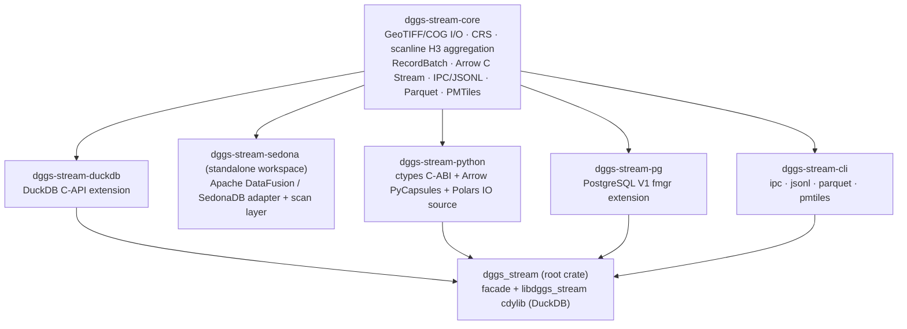

# Multi-Engine Workspace Overview

[← Back to README](../../README.md)

dggs_stream is a Cargo workspace. One pure-Rust engine (`dggs-stream-core`) does all raster
decoding, CRS transformation, H3 aggregation and file export; five thin adapter crates
expose it to different query engines and runtimes. Every adapter drives the same
streamers, so the same raster and parameters produce the same cells and statistics
in every engine.

## Workspace Layout

| Crate | Path | Artifact | Deep Dive |
| :--- | :--- | :--- | :--- |
| `dggs-stream-core` | [`crates/dggs-stream-core`](../../crates/dggs-stream-core) | `rlib` | [Core Engine](core.md) |
| `dggs-stream-duckdb` | [`crates/dggs-stream-duckdb`](../../crates/dggs-stream-duckdb) | `rlib`, linked into `libdggs_stream.{so,dylib,dll}` by the root crate | [DuckDB](duckdb.md) |
| `dggs-stream-sedona` | [`crates/dggs-stream-sedona`](../../crates/dggs-stream-sedona) | `rlib`, standalone workspace (DataFusion version pinned to SedonaDB's) | [DataFusion & SedonaDB](datafusion.md) |
| `dggs-stream-python` | [`crates/dggs-stream-python`](../../crates/dggs-stream-python) | `cdylib` + `dggs-stream` wheel | [Python & Polars](python-polars.md), [Spark & Apache Sedona](spark.md) |
| `dggs-stream-pg` | [`crates/dggs-stream-pg`](../../crates/dggs-stream-pg) | `cdylib` (`dggs_stream_pg.so` with `--features pg-extension`) | [PostgreSQL](postgresql.md) |
| `dggs-stream-cli` | [`crates/dggs-stream-cli`](../../crates/dggs-stream-cli) | `dggs-stream-cli` executable (also built as `dggs-stream` from the root crate) | [CLI](cli.md) |
| `dggs_stream` | [`.`](../../) | `cdylib` + `rlib` facade | — |

The root `dggs_stream` crate re-exports each member under a short name
(`dggs_stream::core`, `::cli`, `::duckdb`, `::datafusion`, `::python`, `::pg`) and
glob-re-exports `dggs_stream_duckdb::*`, so existing `dggs_stream::...` paths and the DuckDB
extension entry points (`dggs_stream_init`, `dggs_stream_init_c_api`, `dggs_stream_version`, plus `raster_h3_*` aliases of all three)
keep working. `cargo build --release` at the root still produces
`target/release/libdggs_stream.{so,dylib,dll}`, the loadable DuckDB extension.

## Engine Capability Matrix

| Capability | DuckDB | DataFusion | Python / Polars | PostgreSQL | CLI |
| :--- | :---: | :---: | :---: | :---: | :---: |
| Continuous aggregation | ✅ | ✅ | ✅ | ✅ | ✅ |
| Categorical aggregation (wide) | ✅ | ✅ | ✅ | ✅ | ✅ |
| Categorical aggregation (long) | ✅ | ✅ | ✅ | — | ✅ |
| Multiple resolutions per scan | ✅ | ✅ | ✅ | — (one `h3_res`) | ✅ |
| CRS override / NoData override / bbox | ✅ | ✅ | ✅ | ✅ | ✅ |
| Sub-pixel sampling, band, spectral formulas | ✅ | ✅ (builder) | ✅ | — | — |
| Quantiles | ✅ | ✅ (builder) | ✅ | — | — |
| Category remapping | ✅ | ✅ | ✅ | — | — |
| `min_count`, `min_mean`, `max_mean`, `min_majority_fraction` | ✅ | ✅ | ✅ | — | — |
| Column projection pushdown | ✅ | ✅ | ✅ | — | ✅ (`--columns`) |
| Row-limit pushdown | — (DuckDB stops pulling) | ✅ | ✅ | — (SRF stops on `LIMIT`) | ✅ (`--limit`) |
| Filter pushdown | named params | `FilterPredicate` | Polars predicates on `count`, `mean`, `majority_fraction`, `resolution` | — | — |
| Parquet / GeoParquet export | ✅ | — | ✅ | — | ✅ |
| PMTiles v3 export | ✅ | ✅ (SedonaDB / DataFusion `COPY ... TO '*.pmtiles'` from any query) | ✅ | — | ✅ |
| Partitioned scans (plan, scan, merge) | ✅ | ✅ (and SedonaDB SQL) | ✅ | — | ✅ (`plan`, `--partition`, `merge`) |
| Parquet → PMTiles transcoding | ✅ | — | ✅ (`parquet_to_pmtiles`) | — | ✅ (`parquet-to-pmtiles`) |
| Grids (`h3`, `a5`, `s2`, `healpix`) ([Grids](../grids.md)) | ✅ | ✅ | ✅ | ✅ | ✅ (`--grid`) |
| `auto` resolution | ✅ | ✅ | ✅ | ✅ (`{grid}_auto_resolution`) | ✅ (`-r auto`) |
| Transfer modes (`interpolate`, `overlay`, `auto`) ([Transfer Modes](../transfer-modes.md)) | ✅ | ✅ | ✅ | — | ✅ |
| Ground-area overlay on EPSG:4326 rasters ([`ground_area`](../transfer-modes.md#ground-area-overlay-ground_area)) | ✅ | — (Rust core only) | ✅ | — | ✅ (`ipc`, `jsonl`) |
| Structured histograms | ✅ (JSON text) | ✅ (`List<Struct>`) | ✅ (`List(Struct)`) | — | ✅ (`ipc`, `jsonl`) |
| NoData policy (`emit`) and `decimals` | ✅ | ✅ | ✅ | ✅ | ✅ |
| Runtime profile | ✅ (`profile := true`) | ✅ (`with_profile`) | ✅ (`profile_raster`) | — | ✅ (`--profile`) |
| Cell scalar helpers (every grid) | ✅ | ✅ (vectorized) | ✅ | ✅ | — |
| Polygon fill (`{grid}_polygon_to_cells`) | ✅ | ✅ | ✅ | — | — |
| Output transport | DuckDB `DataChunk` | `RecordBatch` / `ArrowArrayStream` | Arrow PyCapsule | heap tuples (value-per-call SRF) | `RH3IPC01` / NDJSON / files |

## Same Task, Every Engine

Each deep dive has a recipes section covering the same tasks. The core calls, side by side:

| Task | DuckDB | Python / Polars | PostgreSQL | CLI | DataFusion |
| :--- | :--- | :--- | :--- | :--- | :--- |
| Continuous scan | `h3_raster_continuous_aggregate('dem.tif', resolution := 8)` | `scan_raster("dem.tif", 8)` | `h3_raster_continuous_aggregate('/data/dem.tif', 8)` | `dggs-stream-cli jsonl dem.tif -r 8` | `ContinuousRasterTableProvider::try_new("dem.tif", vec![8])?` |
| Categorical scan | `h3_raster_categorical_aggregate(..., format := 'long')` | `scan_raster(..., categorical=True, format="long")` | `h3_raster_categorical_aggregate(...)` (wide only) | `jsonl ... -c --format long` | `CategoricalRasterTableProvider::try_new(..)?.with_format(Long)` |
| Several resolutions | `resolutions := '7,8'` | `[7, 8]` | one call per resolution | `-r 7,8` | `vec![7, 8]` |
| Another grid | `s2_raster_continuous_aggregate(...)` or `grid := 's2'` | `grid="s2"` | `s2_raster_continuous_aggregate(...)` | `--grid s2` | `.with_grid(GridKind::S2)` or `s2_raster_continuous_aggregate(...)` in SQL |
| Pixel-sized cells | `resolutions := 'auto'` | `"auto"` | `s2_auto_resolution('/data/dem.tif')` | `-r auto` | `'auto'` argument in SQL |
| Area-weighted cells | `transfer := 'overlay'` | `transfer="overlay"` | — | `--transfer overlay` | `.with_transfer(TransferMode::OVERLAY)` |
| Mode chosen for you | `transfer := 'auto'` | `transfer="auto"` | — | `--transfer auto` | `.with_transfer(TransferMode::Auto)` |
| True ground area (lon/lat) | `ground_area := true, transfer := 'overlay'` | `ground_area=True, transfer="overlay"` | — | `--ground-area --transfer overlay` | — (core `scan_ground_area_overlay`) |
| CRS / NoData / bbox | `source_crs :=`, `nodata :=`, `bbox :=` | `crs=`, `nodata=`, `bbox=` | `source_crs =>`, `nodata =>`, `bbox =>` | `--crs`, `--nodata`, `--bbox` | `with_crs`, `with_nodata`, `with_bbox` |
| Band scale/offset | `scale_offset := false` opts out | always applied | always applied | `--raw-values` opts out | `with_scale_offset(false)` opts out |
| Fail on dropped samples | `strict_transforms := true` | `strict_transforms=True` | — (`WARNING` only) | — (stderr warning only) | `with_strict_transforms(true)` |
| GeoParquet export | `h3_raster_to_parquet(...)` | `raster_to_parquet(...)` | — (`COPY` to CSV) | `dggs-stream-cli parquet ... -o` | — (core `ParquetWriter`) |
| PMTiles export | `h3_raster_to_pmtiles(...)` | `raster_to_pmtiles(...)` | — | `dggs-stream-cli pmtiles ... -o` | `COPY (query) TO 'out.pmtiles'` (`dggs-stream-sedona`) |
| Parquet → PMTiles | `h3_parquet_to_pmtiles(...)` | `parquet_to_pmtiles(...)` | — | `dggs-stream-cli parquet-to-pmtiles ... -o` | — (core `process_parquet_to_pmtiles`) |
| Recipes | [DuckDB](duckdb.md#sql-usage--recipes) | [Python](python-polars.md#recipes) | [PostgreSQL](postgresql.md#recipes) | [CLI](cli.md#recipes) | [DataFusion](datafusion.md#recipes) |

Mosaics (globs, comma-separated lists, VRT) are accepted by every adapter through
`resolve_raster_sources`. DuckDB and Python expose the `overlap_rule` choice; DataFusion
exposes it via `with_overlap_rule`; PostgreSQL and the CLI always use `cutline`.

## Shared Semantics

### Output schemas

All engines derive their columns from `dggs_stream_core::columnar::ColumnSchema`. The tables
below show the H3 names; on another grid the cell columns are `{grid}_index` and
`{grid}_hex` (`continuous_for(grid, ..)`, `categorical_wide_for(grid)`, ...). Under
`nodata_policy='emit'` the statistic columns become nullable, and a categorical scan with a
histogram spec makes `histogram` a list of structs ([Scan Options](../scan-options.md)).

| Schema | Columns |
| :--- | :--- |
| `ColumnSchema::continuous(quantiles)` | `h3_index` u64, `h3_hex` utf8, `mean`, `stddev` (nullable), `count`, `min`, `max`, `sum` f64, `resolution` u8, `wkb` binary, then one nullable f64 per quantile target |
| `ColumnSchema::categorical_wide()` | `h3_index`, `h3_hex`, `majority_class` i64, `majority_fraction`, `majority_count`, `unique_classes` i64, `total_count`, `histogram` (JSON text), `resolution`, `shannon_entropy`, `entropy`, `distinct_classes` i64, `wkb` |
| `ColumnSchema::categorical_long()` | `h3_index`, `h3_hex`, `category` i64, `count`, `fraction`, `total_count`, `resolution`, `shannon_entropy`, `entropy`, `distinct_classes`, `unique_classes`, `wkb` |

The DuckDB table functions keep their own historical column sets (documented in the
[DuckDB SQL API Reference](../sql-api-reference.md)); PostgreSQL returns a subset (see
[PostgreSQL](postgresql.md#output-columns)).

### Cell index representation

| Engine | Type of `{grid}_index` |
| :--- | :--- |
| DuckDB | `UBIGINT` |
| DataFusion / Arrow / Python / CLI | `UInt64` (Arrow format `L`) |
| PostgreSQL | `bigint`: the same 64 bits reinterpreted as signed, matching the `h3-pg` convention. Valid H3 and HEALPix ids have the high bit clear, so they are positive; S2 ids on faces 4 and 5 and about half of A5's are negative. The `*_hex` text is always the unsigned id. |

### Scalar helpers

The helpers live once in [`dggs_stream_core::scalar_ops`](../../crates/dggs-stream-core/src/scalar_ops.rs)
and each adapter wraps them. Each grid has the same set under its own prefix (`a5_to_lat`,
`s2_cell_to_parent`, `healpix_lonlat_to_cell`, ...; Python `cell_to_lat(cell, grid=...)`);
the table below names the H3 forms. Core behaviour on invalid input, with the adapter
differences that remain:

| Function | Core behaviour on invalid input | Adapter differences |
| :--- | :--- | :--- |
| `h3_to_string(cell)` | `None` for `0` | DuckDB formats any `UBIGINT`, so `0` becomes `'0'` |
| `string_to_h3(hex)` | `0` | PostgreSQL returns `NULL` |
| `h3_to_lat(cell)`, `h3_to_lng(cell)` | `NaN` | — |
| `h3_get_resolution(cell)` | `-1` | — |
| `h3_is_valid(cell \| hex)` | `false` | — |
| `h3_to_wkb(cell \| hex)` (aliases `h3_to_geometry`, `h3_cell_to_geometry`) | `None` | PostgreSQL has the `bigint` overload only |
| `h3_cell_to_parent(cell, res)` | `None` when `res` is outside `0..=15` or finer than the cell | DuckDB returns `0` |
| `h3_polygon_to_cells(wkb, res[, containment])` ([modes](../sql-api-reference.md#h3_polygon_to_cells)) | `Err` for invalid WKB, a resolution outside `0..=15`, or more than `H3_POLYGON_TO_CELLS_MAX_CELLS` (10,000,000) cells | DuckDB, Python and DataFusion. DuckDB and Python return `NULL` / `None` for invalid geometry or resolution, and raise a query error / `ValueError` for an unknown mode or too many cells. Not in PostgreSQL |

Every engine emits the same cell geometry, from one shared encoder: a `Polygon` for
ordinary cells, a two-part `MultiPolygon` cut at ±180° for cells crossing the
antimeridian, and polar-cap `Polygon`s for the two pole cells, with longitudes always
in [-180, 180]. See [cell geometry](../sql-api-reference.md#cell-geometry).

## Cross-Engine Parity Testing

For the full test inventory, see [Test Coverage](../testing.md).

| Test | What it checks | How to run |
| :--- | :--- | :--- |
| [`root/multi_engine_e2e.rs`](../../tests/it/multi_engine_e2e.rs) | Generates synthetic continuous and categorical GeoTIFFs and compares per-cell results from the core batch readers and Arrow C stream, the CLI (subprocess: `ipc`, `jsonl`, `parquet`, `pmtiles`), DataFusion (scan, pushdown, scalar UDFs), Python (a `python3` subprocess loading `libdggs_stream_python`), the PostgreSQL SRFs and fmgr scalars in-process, and DuckDB when a `duckdb` binary is on `PATH`. | `cargo test -p dggs_stream --test it multi_engine_e2e` |
| [`dggs-stream-sedona/tests/cross_engine.rs`](../../crates/dggs-stream-sedona/tests/cross_engine.rs) and DuckDB's `test_cross_engine_consistency_with_the_cli` | The CLI, DuckDB, the Python scanner and DataFusion SQL on all four grids: the same cells and statistics for centre assignment, `emit` with `decimals`, mass-preserving `overlay` and bilinear / bicubic `interpolate`, plus checks of the shared result (mass conservation, a linear field reproduced by interpolation). | `cargo test --test cross_engine` in `crates/dggs-stream-sedona`; `cargo test -p dggs-stream-duckdb test_cross_engine` |
| [`root/pg_extension_e2e.rs`](../../tests/it/pg_extension_e2e.rs) | Builds the real PostgreSQL module in Docker, installs it into `postgres:<major>` containers and compares `psql` output to the in-process SRFs. | `cargo test -p dggs_stream --test it pg_extension_e2e -- --ignored --nocapture` |
| [`crates/dggs-stream-python/tests/wheel_smoke.py`](../../crates/dggs-stream-python/tests/wheel_smoke.py) | Installs a built wheel and exercises the Python API and the bundled `dggs-stream-cli`. | Run by `cibuildwheel` in [`wheels.yml`](../../.github/workflows/wheels.yml) |

## Choosing an Engine

| You want… | Use |
| :--- | :--- |
| SQL joins against other tables, Parquet/PMTiles export from SQL | [DuckDB](duckdb.md) |
| A Rust query engine or service that consumes Arrow batches | [DataFusion](datafusion.md) or the [Core Engine](core.md) directly |
| Notebooks, Polars `LazyFrame`s, PyArrow, GeoPandas/Lonboard | [Python & Polars](python-polars.md) |
| Rasters aggregated inside an existing PostgreSQL / PostGIS database | [PostgreSQL](postgresql.md) |
| Shell pipelines, ClickHouse executable table functions, batch jobs | [CLI](cli.md) |
